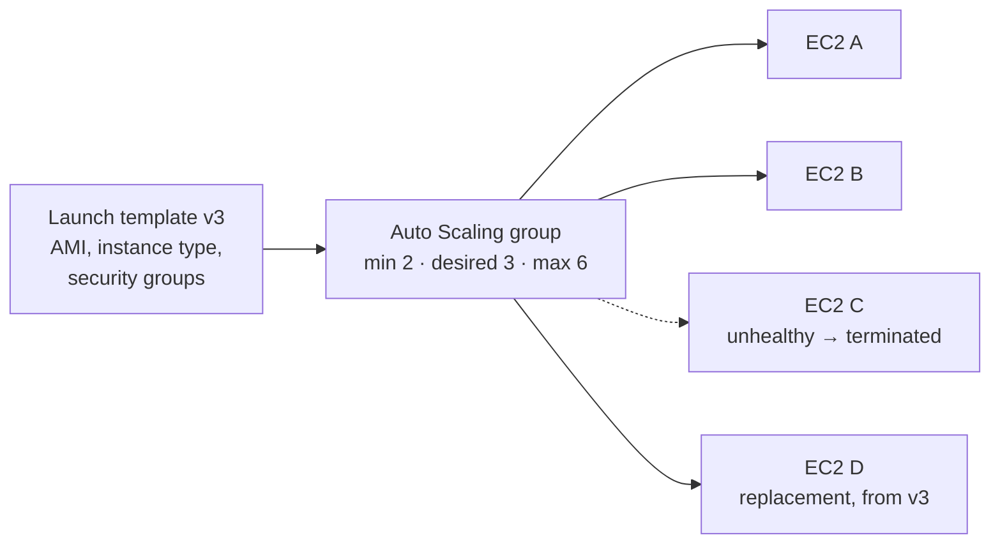
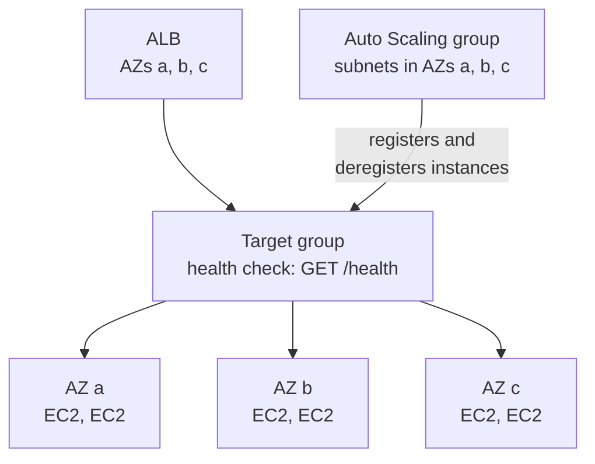
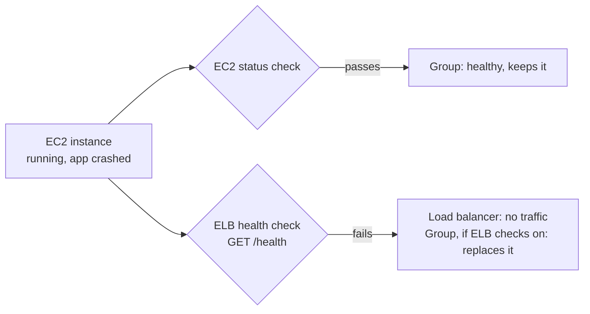
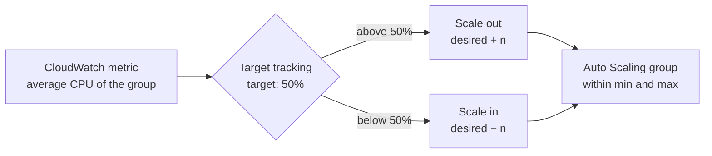
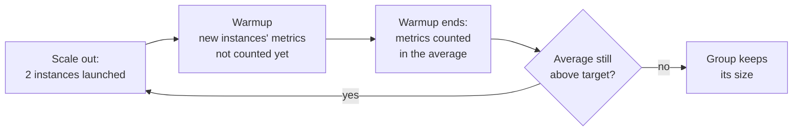
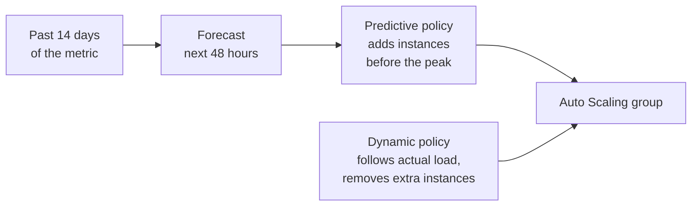
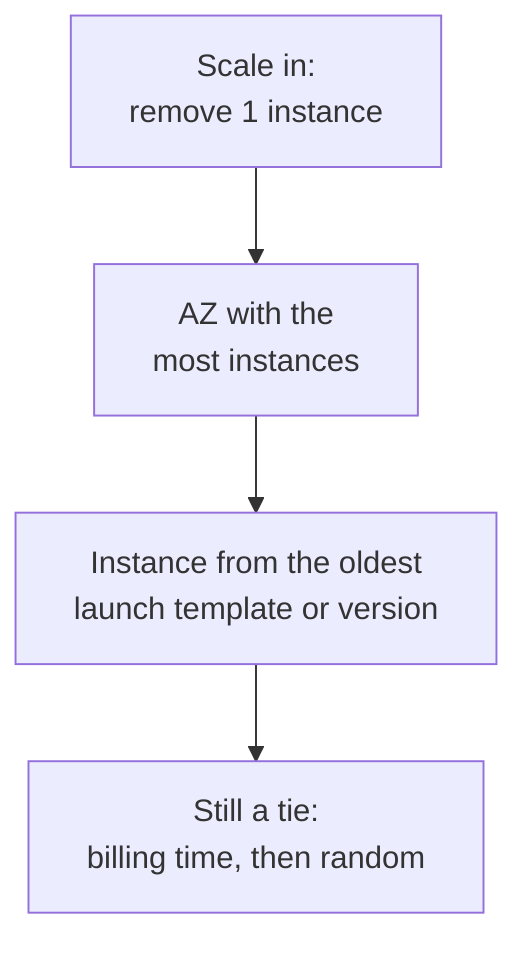
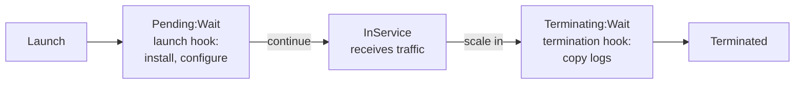

# Auto Scaling groups

EC2 Auto Scaling keeps the right number of EC2 instances running: it
replaces instances that break and adds or removes instances as load
changes. It doesn't handle traffic itself; a load balancer in front
spreads requests across the instances.

## What an Auto Scaling group is

An Auto Scaling group is a set of EC2 instances managed as one unit. You
say how many instances you want; the group launches or terminates
instances to match.

| Number | Meaning |
|---|---|
| Minimum | The group never goes below this. |
| Desired | How many instances the group should have now. |
| Maximum | The group never goes above this. |

The desired number is the one that moves: you set it yourself, or
scaling policies change it, always within the minimum and maximum.
Without any scaling set up, the group stays at its desired number.

### The launch template

The recipe for every instance the group launches: the AMI (the disk
image with the operating system and app), instance type, security
groups, key pair and other settings. Every instance comes from the same
recipe, so any one can be replaced by another.

- Templates have versions: a new app release is a new template version
  with a new AMI.
- Launch configurations are the older recipe. Use launch templates:
  some features, such as mixing instance types or Spot, need them.

### Replacing broken instances

If an instance fails a health check or ends unexpectedly (a Spot
interruption, someone terminating it), the group launches a new one from
the current template to get back to the desired number. It replaces the
instance, it doesn't repair it, so don't keep data only on an instance
in the group.

Worth knowing:

- Auto Scaling itself is free; you pay for the instances, volumes and
  CloudWatch alarms it uses.
- AWS Auto Scaling is a separate service: one place to set up scaling for
  several kinds of resources, such as Auto Scaling groups, ECS services,
  DynamoDB tables and Aurora read replicas.

## AZs and the load balancer

### Spreading across AZs

You assign subnets to the Auto Scaling group, ideally one per AZ. Since each subnet lives in a single AZ, the subnets you choose determine which AZs the group uses.

- Each new instance launches in the AZ with the fewest instances, so the group stays balanced.
- If an AZ can't launch instances, the group launches them in the other
  AZs to keep the desired number.
- When the AZ recovers, the group rebalances.

### Attaching a load balancer

When you attach the Auto Scaling group to a target group, the Auto Scaling group keeps the target group up to date:

- Instances it launches are registered in the target group; instances it
  terminates are deregistered. Before terminating, it waits out the
  target group's deregistration delay so in-flight requests finish.
- Use the same AZs for the Auto Scaling group and the load balancer. An instance in an AZ that isn't enabled on the ALB shows as `unused` and receives no traffic.

### Which health checks count

| Check | Asks | On? |
|---|---|---|
| EC2 status checks | Is the instance running, with no hardware or system fault? | Always |
| ELB health checks | Does the app answer the load balancer's health check? | Only if you turn it on |

With only EC2 health checks, an instance whose app has crashed but whose machine is still running counts as healthy. The load balancer stops sending it traffic, but the Auto Scaling group never replaces it. Turn on ELB health checks so the group replaces instances like this automatically. (For the ALB's own health check settings, see [Health checks](../../networking/elb/application-load-balancer.md#health-checks).)

## Scaling policies and dynamic scaling

A scaling policy changes the desired number of instances based on an
Amazon CloudWatch metric. CloudWatch is AWS's monitoring service: a
metric is a value it records over time, such as CPU use, and an alarm
goes off when a metric crosses a threshold. For an Auto Scaling group,
the metric is usually the average across all its instances.

Scaling out adds instances; scaling in removes them. A policy never moves
the desired number outside the minimum and maximum.

Dynamic scaling responds to load as it changes, when you don't know in
advance when it will change. It uses three policy types:

| Policy type | How it works | Alarms |
|---|---|---|
| Target tracking | You choose a metric and a target value, such as average CPU at 50%. The Auto Scaling group adds or removes instances to stay near it, like a thermostat. | Created and managed by AWS; don't edit them. |
| Step scaling | The adjustment depends on how far the metric passes the threshold, such as +1 instance above 60% CPU and +3 above 80%. | Created by you. |
| Simple scaling | One fixed adjustment per alarm, such as +2 instances, followed by a cooldown. | Created by you. |

### Cooldown and instance warmup

| Setting | Applies to | What it does |
|---|---|---|
| Scaling cooldown | Simple scaling only | After a scaling activity, simple scaling policies wait for the cooldown to end before acting again. Default: 300 seconds. |
| Instance warmup | Target tracking and step scaling | A new instance's metrics aren't counted in the average until its warmup ends; scaling in also waits. Off by default; AWS suggests starting with 300 seconds. |

AWS recommends against simple scaling and cooldowns: target tracking or
step scaling with an instance warmup responds better.

## Scheduled and predictive scaling

Dynamic scaling reacts after the load changes. Scheduled and predictive
scaling act before it changes, when the load can be known or predicted.

### Scheduled scaling

A scheduled action sets the Auto Scaling group's minimum, maximum or
desired number at a date and time you choose.

- It runs once (desired 20 on the morning of a product launch) or on a
  recurring schedule written as a cron expression (desired 10 every
  weekday at 8:00, desired 2 at 20:00).
- Times are in UTC unless you set a time zone.
- After it runs, dynamic policies can still adjust the number, within the
  minimum and maximum it set.

Use it when the load changes at known times.

### Predictive scaling

A predictive scaling policy studies past load and launches instances
before the load arrives.

- It analyzes up to 14 days of a metric and forecasts the next 48 hours,
  updating the forecast every 6 hours. It needs at least 24 hours of
  data.
- It only scales out. Pair it with a dynamic policy to remove instances
  when the load drops.
- In forecast-only mode, it shows the forecast without scaling, so you can
  check its accuracy first.

Use it when the load repeats daily or weekly, or when instances take a
long time to start.

### Choosing a scaling method

| Load | Method |
|---|---|
| Changes at known times | Scheduled scaling |
| Repeats daily or weekly | Predictive scaling, plus dynamic scaling |
| Changes without warning | Dynamic scaling (target tracking) |

When several policies apply at once, the Auto Scaling group uses the one
that gives the most instances.

## Removing instances safely

### Which instance is removed first

When the Auto Scaling group scales in, its termination policy chooses the
instance. The default policy:

1. Picks the AZ with the most instances, so the group stays balanced.
2. In that AZ, picks an instance launched from an older launch template
   or template version.
3. Breaks any remaining tie by billing time, then at random.

Other policies exist, such as `OldestInstance` and `NewestInstance`, and
you can write your own as a Lambda function. Unhealthy instances are
replaced regardless of the termination policy.

### Scale-in protection

Scale-in protection keeps an instance from being removed when the Auto
Scaling group scales in, for example while it finishes a long job. You
can turn it on for one instance or for all new instances in the group.

It doesn't protect against replacement after a failed health check, a
Spot interruption or manual termination.

### Lifecycle hooks

A lifecycle hook pauses an instance as it launches or terminates, so you
can run a step first.

| Hook | The instance waits in | Typical use |
|---|---|---|
| Launch | `Pending:Wait`, before entering service | Install software or load data before it receives traffic. |
| Termination | `Terminating:Wait`, before ending | Copy logs or data off the instance. |

## Sources

- [What is Amazon EC2 Auto Scaling?](https://docs.aws.amazon.com/autoscaling/ec2/userguide/what-is-amazon-ec2-auto-scaling.html):
  Auto Scaling groups, minimum, maximum and desired capacity, replacing
  impaired instances, no extra fee.
- [Choose your scaling method](https://docs.aws.amazon.com/autoscaling/ec2/userguide/scaling-overview.html):
  without scaling policies the group keeps a fixed size.
- [Auto Scaling launch templates](https://docs.aws.amazon.com/autoscaling/ec2/userguide/launch-templates.html):
  what a template holds, versions, launch templates recommended over
  launch configurations.
- [Health checks for instances in an Auto Scaling group](https://docs.aws.amazon.com/autoscaling/ec2/userguide/ec2-auto-scaling-health-checks.html):
  unhealthy or unexpectedly terminated instances replaced from the
  current template.
- [Auto Scaling benefits for application architecture](https://docs.aws.amazon.com/autoscaling/ec2/userguide/auto-scaling-benefits.html):
  even spread across AZs, launching in other AZs, rebalancing.
- [Use Elastic Load Balancing with your Auto Scaling group](https://docs.aws.amazon.com/autoscaling/ec2/userguide/autoscaling-load-balancer.html):
  automatic registration and deregistration.
- [About the health checks for your Auto Scaling group](https://docs.aws.amazon.com/autoscaling/ec2/userguide/health-checks-overview.html):
  EC2 status checks always on, ELB health checks off until turned on,
  waiting for the deregistration delay.
- [Target groups for your Application Load Balancers](https://docs.aws.amazon.com/elasticloadbalancing/latest/application/load-balancer-target-groups.html):
  targets in an AZ not enabled for the load balancer aren't used.
- [Dynamic scaling for Amazon EC2 Auto Scaling](https://docs.aws.amazon.com/autoscaling/ec2/userguide/as-scale-based-on-demand.html):
  the three policy types, metric averaged across the group, limits of the
  minimum and maximum, the policy giving the most instances wins.
- [Target tracking scaling policies](https://docs.aws.amazon.com/autoscaling/ec2/userguide/as-scaling-target-tracking.html):
  alarms managed by AWS.
- [Step and simple scaling policies](https://docs.aws.amazon.com/autoscaling/ec2/userguide/as-scaling-simple-step.html):
  alarms created by you, step adjustments, one adjustment plus cooldown.
- [Scaling cooldowns](https://docs.aws.amazon.com/autoscaling/ec2/userguide/ec2-auto-scaling-scaling-cooldowns.html):
  simple scaling only, 300 seconds by default, not recommended.
- [Set the default instance warmup](https://docs.aws.amazon.com/autoscaling/ec2/userguide/ec2-auto-scaling-default-instance-warmup.html):
  metrics excluded during warmup, scale-in waits, off by default, start
  with 300 seconds.
- [Scheduled scaling for Amazon EC2 Auto Scaling](https://docs.aws.amazon.com/autoscaling/ec2/userguide/ec2-auto-scaling-scheduled-scaling.html):
  what a scheduled action sets, one-time or recurring, UTC by default,
  dynamic scaling afterwards.
- [Predictive scaling for Amazon EC2 Auto Scaling](https://docs.aws.amazon.com/autoscaling/ec2/userguide/ec2-auto-scaling-predictive-scaling.html):
  suited to cyclical load and slow-starting applications.
- [How predictive scaling works](https://docs.aws.amazon.com/autoscaling/ec2/userguide/predictive-scaling-policy-overview.html):
  14 days analyzed, 48-hour forecast updated every 6 hours, 24 hours of
  data minimum, scale-out only, forecast-only mode, the highest capacity
  used when combined with dynamic scaling.
- [Termination policies for Amazon EC2 Auto Scaling](https://docs.aws.amazon.com/autoscaling/ec2/userguide/ec2-auto-scaling-termination-policies.html):
  the default policy's order, other predefined policies, unhealthy
  instances outside termination policies.
- [Create a custom termination policy with Lambda](https://docs.aws.amazon.com/autoscaling/ec2/userguide/custom-termination-policy.html):
  custom policies as Lambda functions.
- [Use instance scale-in protection](https://docs.aws.amazon.com/autoscaling/ec2/userguide/ec2-auto-scaling-instance-protection.html):
  what it protects against and what it doesn't, setting it for new
  instances.
- [Amazon EC2 Auto Scaling lifecycle hooks](https://docs.aws.amazon.com/autoscaling/ec2/userguide/lifecycle-hooks.html):
  launch and termination hooks, typical uses.
- [How lifecycle hooks work](https://docs.aws.amazon.com/autoscaling/ec2/userguide/lifecycle-hooks-overview.html):
  wait states.
- [What is a scaling plan?](https://docs.aws.amazon.com/autoscaling/plans/userguide/what-is-a-scaling-plan.html):
  AWS Auto Scaling and the resources it supports.
