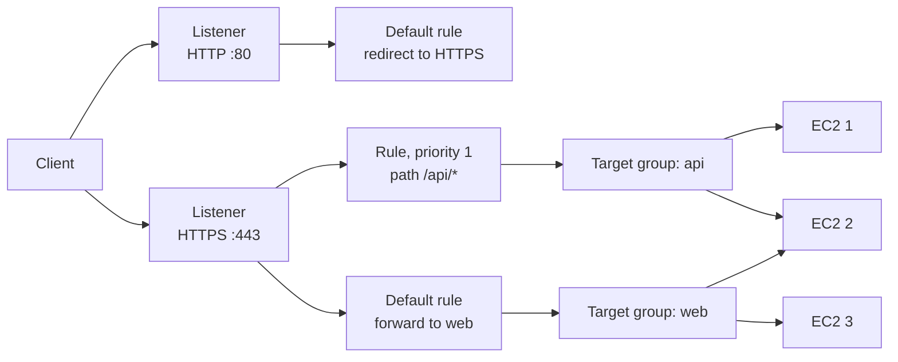
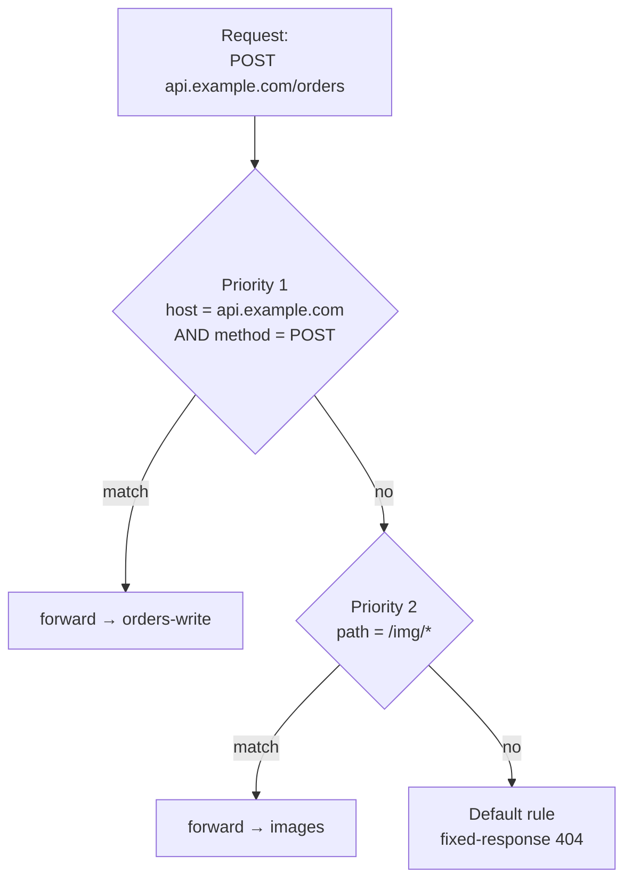
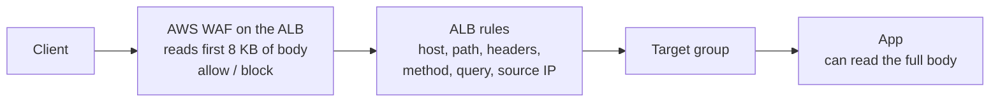
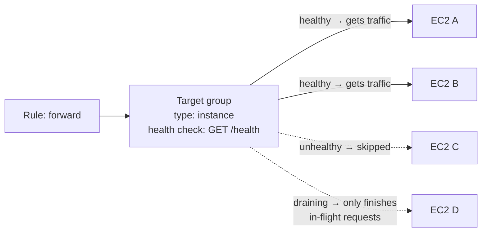
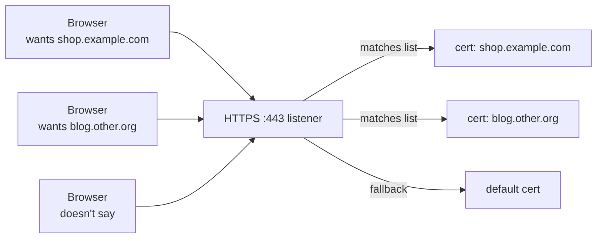
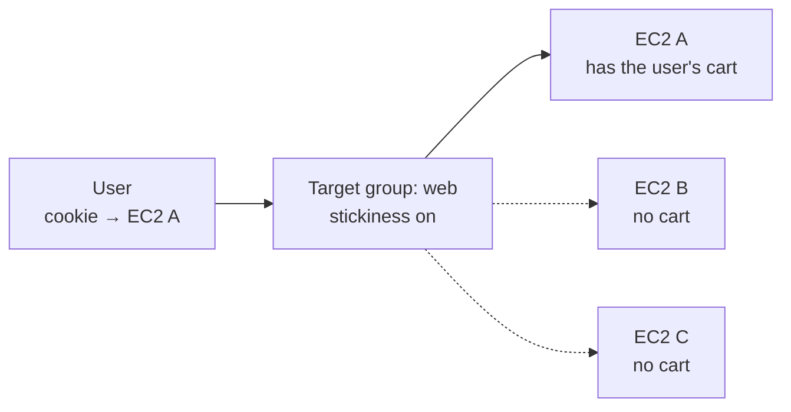
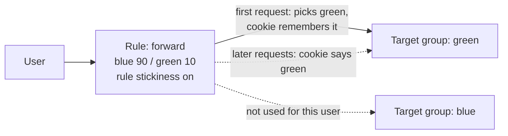

# Application Load Balancer (ALB)

ELB's layer 7 load balancer: it reads each HTTP request (host, path,
headers) and routes it on that content. For what all ELB types share
(nodes, subnets, scheme, cross-zone), see
[Elastic Load Balancing (ELB)](elastic-load-balancing.md).

## The building blocks

| Part | Answers | What it is |
|---|---|---|
| Listener | Which traffic do I accept? | A process waiting for connections on one protocol and port (HTTP or HTTPS, 1–65535). No listener, no traffic. |
| Rule | Where does this request go? | Belongs to a listener: a priority, one or more conditions, one or more actions. |
| Target group | Which servers, and are they healthy? | A set of targets plus the protocol and port to reach them. Health checks are set here. |
| Target | Who does the work? | An EC2 instance, an IP address or a Lambda function. |

How a request moves through them:

1. The client resolves the ALB's DNS name and connects to a node (see
   [Fixed IPs for an ALB](elastic-load-balancing.md#fixed-ips-for-an-alb)).
2. The listener for that protocol and port accepts the connection.
3. It checks its rules in priority order, lowest number first; the first
   match runs its actions.
4. Every listener has a default rule, which can't be deleted and is
   checked last, so every request is handled.
5. A forward action sends the request to a target group, which picks a
   healthy target (round robin by default).

Worth knowing:

- One target can be in several target groups (EC2 2 above), for example
  on different ports. Each group routes and health checks on its own.
- A target group belongs to one load balancer only.
- Health checks run only on targets in a target group that a rule uses,
  and only in AZs enabled for the ALB.

## Rules: conditions and actions

A rule says: if the request matches these conditions, run these actions.

| Condition | Matches | Example |
|---|---|---|
| `host-header` | the domain requested | `api.example.com`, `*.example.com` |
| `path-pattern` | the URL path, not the query string | `/img/*` |
| `http-header` | any header, by name | `User-Agent` matches `*Mobile*` |
| `http-request-method` | GET, POST, … | `POST` |
| `query-string` | key/value pairs after `?` | `version=v1` |
| `source-ip` | the client's IP range (CIDR) | `192.0.2.0/24` |

| Action | Does |
|---|---|
| `forward` | sends to one target group, or to several by weight |
| `redirect` | returns 301 (permanent) or 302 (temporary) to a new URL, e.g. HTTP → HTTPS |
| `fixed-response` | the ALB answers itself with a status code and optional body |
| `authenticate-cognito`, `authenticate-oidc` | signs the user in first (HTTPS listeners only) |

Each rule ends with exactly one of `forward`, `redirect` or
`fixed-response`; a sign-in action can come before it.

### Rules can't read the body

No condition looks at the request body. To act on it:

- **Block or allow:** AWS WAF on the ALB inspects the first 8 KB of the
  body (fixed for an ALB), then allows, blocks or counts the request. It
  can't choose a target group.
- **Route:** the app behind the ALB reads the body and decides. Or have
  the client put the deciding value where a rule can see it, such as a
  header or the path.

## Target groups

### Target type

Set at creation; it can't be changed.

| Type | You register | Good for |
|---|---|---|
| `instance` | EC2 instance IDs | the usual case; Auto Scaling registers and deregisters instances for you |
| `ip` | private IPs (RFC 1918 or 100.64.0.0/10) | containers, and servers outside the VPC: peered VPCs, on-premises over Direct Connect or VPN |
| `lambda` | one Lambda function | serverless backends; the ALB invokes the function |

### Health checks

The ALB sends an HTTP `GET` to each target on a timer:

| Setting | Default |
|---|---|
| Protocol, port | HTTP, the traffic port |
| Path | `/` (better: a real page such as `/health`) |
| Interval | 30 s |
| Timeout | 5 s |
| Unhealthy after | 2 failures in a row |
| Healthy again after | 5 successes in a row |
| Success codes | `200` |

Target states: `initial` (registering, first checks), `healthy`,
`unhealthy`, `unused` (no rule uses the group, AZ not enabled, or instance
stopped), `draining` (being removed), `unavailable` (checks turned off).

### How targets get traffic

| Setting | Default | What it does |
|---|---|---|
| Routing algorithm | round robin | **Round robin**: take turns. **Least outstanding requests**: fewest requests in progress; for requests of uneven cost. **Weighted random**: random; can send less traffic to a target erroring more than its peers. |
| Deregistration delay | 300 s | A removed target gets no new requests but has this long to finish in-flight ones (`draining`). |
| Slow start | off (30–900 s) | A new healthy target's share of traffic grows over this time, so it can warm up. Round robin only. |

## HTTPS on the ALB

The ALB decrypts HTTPS so it can read each request and route it. For the
choices of who decrypts (the ALB, the targets, or both), see
[Who decrypts the traffic](elb-overview.md#who-decrypts-the-traffic).

An HTTPS listener needs two things:

- A certificate, which proves to the browser that the ALB really is your
  site.
- A security policy: the list of TLS versions and encryption methods the
  ALB accepts. You pick one of AWS's; newer ones accept only newer, safer
  versions.

### Many sites on one listener

SNI (Server Name Indication) is the browser naming the site it wants,
such as `shop.example.com`, at the very start of an HTTPS connection,
before the ALB sends a certificate. That lets the ALB pick the right
certificate for that site.

The listener has a default certificate and an optional list of others;
the ALB picks the one that matches. The default is used when nothing
matches or the browser doesn't name a site.

## Sticky sessions and weighted target groups

For what these are and their trade-offs, see
[Sticky sessions](elb-overview.md#sticky-sessions) and
[Safer deployments](elb-overview.md#safer-deployments).

### Sticky sessions

Stickiness is turned on per target group, but each user is still stuck
to one target in it, and only that target has their data.

- It needs cross-zone load balancing on, and doesn't work with the
  weighted random algorithm.
- With the ALB's own cookie, you choose how long a user stays stuck:
  1 second to 7 days, 1 day by default.

### Weighted target groups and stickiness

A blue/green split runs two versions of an app side by side, each in its
own target group: "blue" is the current version, "green" the new one
(the colors are only labels). A rule sends a share of requests to each,
for example 90% to blue and 10% to green.

The rule makes that choice again for every request, so the same user can
get blue on one click and green on the next. Turning on stickiness on the
rule keeps each user on the target group they got first.

| Stickiness | Keeps the user on | Set on |
|---|---|---|
| Target stickiness | the same target | the target group |
| Rule stickiness | the same target group | the forward rule |

## Sources

- [What is an Application Load Balancer?](https://docs.aws.amazon.com/elasticloadbalancing/latest/application/introduction.html):
  components, rules evaluated in priority order, round robin by default,
  one target in several target groups.
- [Listeners for your Application Load Balancers](https://docs.aws.amazon.com/elasticloadbalancing/latest/application/load-balancer-listeners.html):
  HTTP/HTTPS, ports 1–65535, the default rule can't be deleted and runs
  last.
- [Target groups for your Application Load Balancers](https://docs.aws.amazon.com/elasticloadbalancing/latest/application/load-balancer-target-groups.html):
  one load balancer per target group, health checks only on targets in a
  rule's target group and in enabled AZs, target types, private IP ranges
  for `ip` targets.
- [Listener rules for your Application Load Balancer](https://docs.aws.amazon.com/elasticloadbalancing/latest/application/listener-rules.html):
  lowest priority value first, default rule last, exactly one final
  action.
- [Condition types for listener rules](https://docs.aws.amazon.com/elasticloadbalancing/latest/application/rule-condition-types.html):
  the six conditions.
- [Action types for listener rules](https://docs.aws.amazon.com/elasticloadbalancing/latest/application/rule-action-types.html):
  weighted forward, 301/302 redirects, fixed response, authentication on
  HTTPS listeners only, target group stickiness for weighted forwards.
- [Oversize web request components in AWS WAF](https://docs.aws.amazon.com/waf/latest/developerguide/web-request-body-inspection.html):
  first 8 KB of the body for an ALB.
- [Health checks for Application Load Balancer target groups](https://docs.aws.amazon.com/elasticloadbalancing/latest/application/target-group-health-checks.html):
  settings and defaults, target states.
- [Edit target group attributes for your Application Load Balancer](https://docs.aws.amazon.com/elasticloadbalancing/latest/application/edit-target-group-attributes.html):
  routing algorithms, deregistration delay, slow start and its limits;
  sticky sessions per target group, needing cross-zone, not with weighted
  random, 1 second to 7 days (1 day by default).
- [SSL certificates for your Application Load Balancer](https://docs.aws.amazon.com/elasticloadbalancing/latest/application/https-listener-certificates.html):
  default certificate, certificate list chosen by SNI.
- [Security policies for your Application Load Balancer](https://docs.aws.amazon.com/elasticloadbalancing/latest/application/describe-ssl-policies.html):
  what a security policy is, AWS's policies only.
