# Elastic Load Balancing (ELB)

AWS's load balancing service. For the general concepts (listeners, target
groups, health checks, layers, TLS), see
[Load balancers – Overview](elb-overview.md).

## The four load balancer types

| Type | Layer | Listens for | Targets | Use it for |
|---|---|---|---|---|
| ALB (Application) | 7 | HTTP, HTTPS, gRPC | instance, IP, Lambda | routing on request content (path, host, headers) |
| NLB (Network) | 4 | TCP, UDP, TLS | instance, IP, ALB | non-HTTP protocols, a static IP per AZ, very high throughput |
| GWLB (Gateway) | 3 | any IP packet | instance, IP | passing traffic through security appliances |
| Classic (CLB) | 4/7 | TCP, SSL/TLS, HTTP, HTTPS | instances | previous generation, built for EC2-Classic; migrate to a current type |

ALB, NLB and GWLB share one API; Classic has its own. An *appliance* is a
VM running network software (a third-party firewall, intrusion
detection). A GWLB is transparent: packets pass through the appliance and
continue to their original destination, so it never replaces a front door
like an ALB.

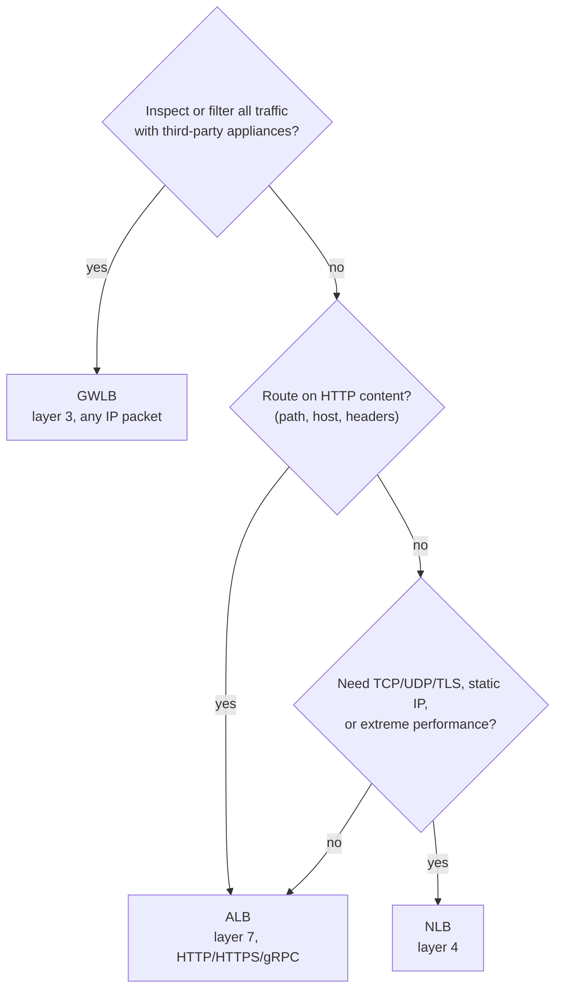

### Fixed IPs for an ALB

An ALB's IP addresses aren't fixed: AWS changes them as it adds or
replaces the ALB's nodes, and you can't assign your own Elastic IPs to an
ALB. What stays fixed is the ALB's DNS name: AWS keeps it pointing at the
current node IPs, so clients and your domain use the name, not the IPs.

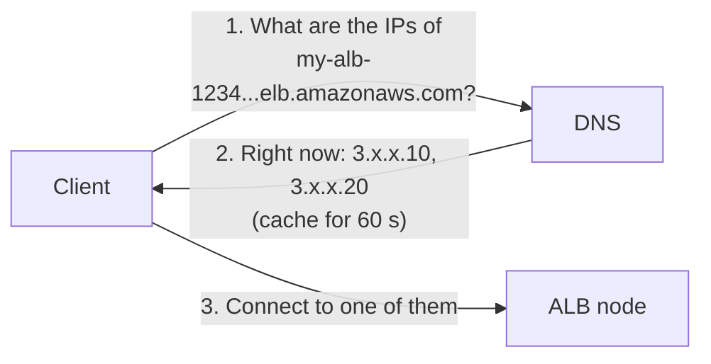

When clients need fixed IPs, such as a partner whose firewall only
lets its servers reach listed addresses, put one of these in front:

- **An NLB with the ALB as its target.** The NLB has a static IP per AZ,
  optionally your own Elastic IP. The ALB still does the content routing.
- **Global Accelerator**, which gives two static anycast IPv4 addresses,
  each announced from many AWS edge locations (see
  [Integrations](#integrations)).

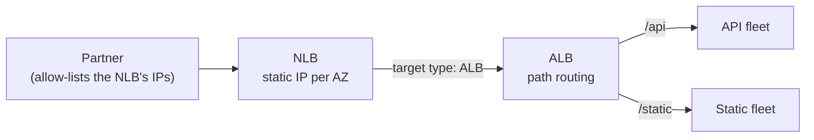

## Nodes, subnets and scheme

You enable an AZ by picking **one subnet** in it, and ELB puts a load
balancer node there. An ALB needs at least two AZs. You can't pick two
subnets in the same AZ, since each AZ gets exactly one node:

| Subnets picked | Valid for an ALB? |
|---|---|
| `public-a1` (AZ A) + `public-b` (AZ B) | yes: two AZs, two nodes |
| `public-a1` + `public-a2` (both AZ A) | no: one AZ |
| `public-a1` alone | no: an ALB needs two AZs |

AWS recommends several AZs for every type; only the ALB requires two.

- **Subnet size:** each ALB subnet must be big enough (at least 32
  addresses in total) and must keep at least 8 addresses unused. The ALB
  takes addresses from the subnet when it adds or replaces nodes. If none
  are left, existing nodes keep serving but the ALB can't grow: during a
  spike clients get 5xx errors or timeouts, and the ALB shows
  `active_impaired`.
- **Targets in an AZ that isn't enabled get no traffic.** They stay
  registered, aren't health checked, and show `unused` with reason
  `Target.NotInUse`.

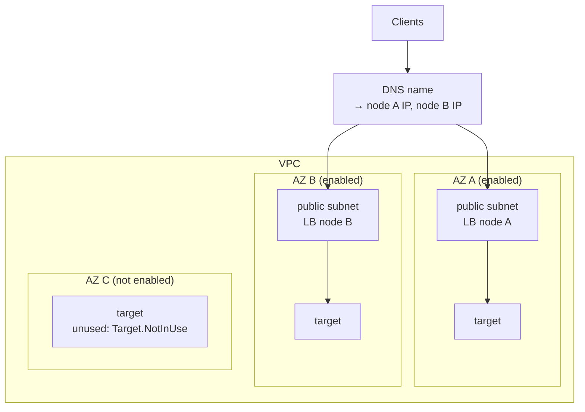

### Scheme

The **scheme** decides who can reach the load balancer: anyone on the
internet (internet-facing) or only clients inside the VPC (internal). You
set it at creation and can't change it; switching means creating a new
load balancer. The default is internet-facing. A GWLB has no scheme.

| | Internet-facing | Internal |
|---|---|---|
| Node IPs | public | private only |
| DNS name resolves to | public IPs | private IPs |
| Reachable by | clients on the internet | clients with access to the VPC |
| Subnets | public (route to an internet gateway) | private |

Either way, the load balancer reaches targets on their private IPs, so
targets never need public IPs.

A common layout uses both: an internet-facing ALB in front of the web
servers, and an internal ALB between the web servers and the app servers.
The internal ALB's DNS name still resolves from anywhere, to private IPs.
That's harmless: private (RFC 1918) addresses aren't routed on the
internet. Its security group should also accept traffic only from the web
servers' security group:

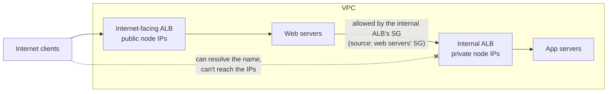

## Cross-zone load balancing

A target group isn't tied to one AZ: one group can hold targets in every
enabled AZ.

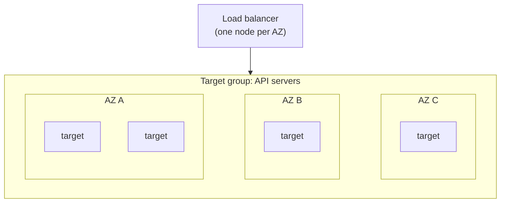

**Cross-zone load balancing** decides whether a node may send traffic to
targets in other AZs, or only to targets in its own AZ. DNS splits clients
evenly across the nodes, whatever the number of targets behind each one.
With 2 targets in AZ A and 8 in AZ B:

**Off:** each node uses only its own AZ's targets.

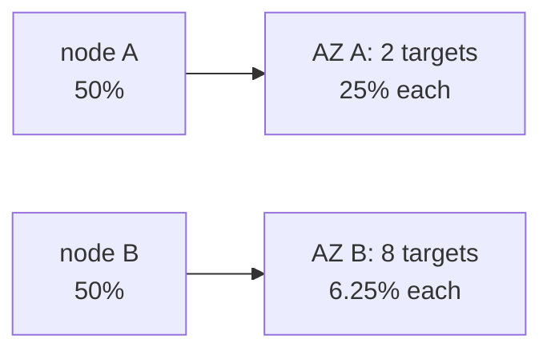

**On:** each node uses every target in every enabled AZ.

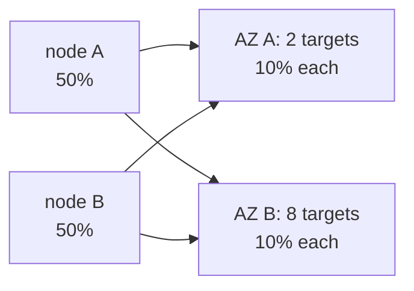

| Type | Default | Where to change it | Traffic between AZs |
|---|---|---|---|
| ALB | always on at the load balancer | can be turned off per target group | free |
| NLB | off | load balancer; a target group can override it | charged when on |
| GWLB | off | load balancer | charged when on |

Reasons to leave it off:
- **Zonal isolation:** each AZ is its own failure domain, so a problem in
  one AZ doesn't reach the others.
- **Latency and cost:** no extra hop between AZs, and no charges for
  traffic between AZs on an NLB or GWLB.

When it's off, each AZ needs enough targets to carry its node's full
share. If the load balancer has several target groups, give each one
targets in every enabled AZ. With cross-zone off, a node can only use
targets in its own AZ, and an AZ where a target group has no targets
counts as unhealthy.

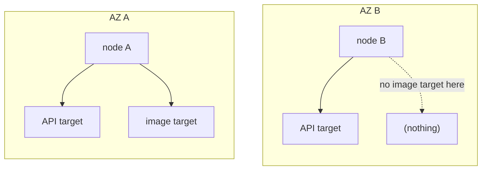

## Integrations

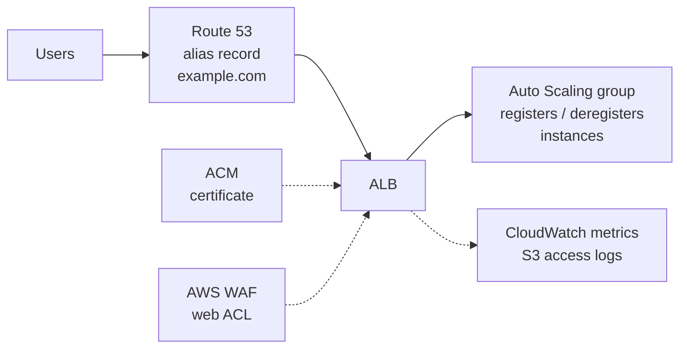

| Service | Role |
|---|---|
| Route 53 | points your domain at the load balancer with an alias record |
| ACM (AWS Certificate Manager) | provides the certificate for an HTTPS (ALB) or TLS (NLB) listener |
| EC2 Auto Scaling | registers the instances it launches and deregisters the ones it terminates. It judges health by EC2 status checks only, unless you also turn on ELB health checks, which is what gets an instance with a dead app replaced |
| AWS WAF | filters HTTP requests with a web ACL; of the ELB types, ALB only |
| CloudWatch, access logs | metrics, including per AZ; access logs go to S3 and are off by default |

### More than one Region

A load balancer lives in one Region. Two ways to use several:

**Route 53 failover.** With *evaluate target health* on, Route 53 checks
the primary load balancer's target groups. If they're unhealthy or
empty, it answers with the secondary.

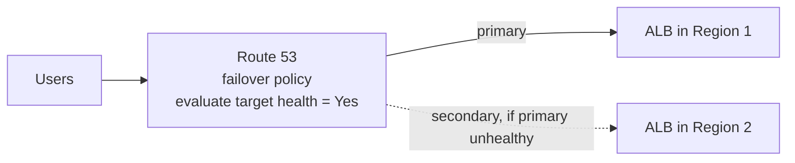

**Global Accelerator.** Two static *anycast* IPv4 addresses, meaning each
address is announced from many AWS edge locations at once and users reach
a nearby one. Traffic then crosses the AWS network to the nearest healthy
endpoint. It doesn't depend on DNS caches, and its fixed IPs can sit in
front of an ALB, whose own IPs keep changing.

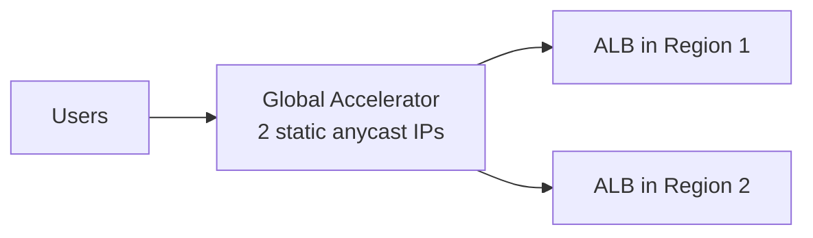

## Sources

- [What is Elastic Load Balancing?](https://docs.aws.amazon.com/elasticloadbalancing/latest/userguide/what-is-load-balancing.html):
  the types, Classic as previous generation, the two APIs, related
  services (Auto Scaling registration, ACM, WAF with ALB, Global
  Accelerator).
- [Elastic Load Balancing features](https://aws.amazon.com/elasticloadbalancing/features/):
  layers, protocols, target types, static IP, use cases.
- [How Elastic Load Balancing works](https://docs.aws.amazon.com/elasticloadbalancing/latest/userguide/how-elastic-load-balancing-works.html):
  nodes per AZ, ELB scaling and DNS, NLB static IPs, scheme, cross-zone
  example and defaults.
- [Application Load Balancers](https://docs.aws.amazon.com/elasticloadbalancing/latest/application/application-load-balancers.html):
  subnet rules, `/27` and 8 free IPs, `active_impaired`, access logs off
  by default.
- [Health checks for ALB target groups](https://docs.aws.amazon.com/elasticloadbalancing/latest/application/target-group-health-checks.html):
  `unused` and `Target.NotInUse`.
- [Troubleshoot your Application Load Balancers](https://docs.aws.amazon.com/elasticloadbalancing/latest/application/load-balancer-troubleshooting.html):
  internet-facing load balancers need public subnets.
- [AWS::ElasticLoadBalancingV2::LoadBalancer](https://docs.aws.amazon.com/AWSCloudFormation/latest/TemplateReference/aws-resource-elasticloadbalancingv2-loadbalancer.html)
  (CloudFormation): scheme fixed at creation, its default, none for a
  GWLB; no Elastic IPs on an ALB.
- [RFC 1918](https://www.rfc-editor.org/rfc/rfc1918.html), Section 3:
  private address ranges.
- [NLB target group attributes: Cross-zone](https://docs.aws.amazon.com/elasticloadbalancing/latest/network/edit-target-group-attributes.html#target-group-cross-zone):
  target group override, failure domains, capacity, empty AZs.
- [Elastic Load Balancing FAQs](https://aws.amazon.com/elasticloadbalancing/faqs/):
  cross-zone charges by type.
- [Routing traffic to an ELB load balancer](https://docs.aws.amazon.com/Route53/latest/DeveloperGuide/routing-to-elb-load-balancer.html)
  (Route 53): alias records for load balancers.
- [Health checks for Auto Scaling instances](https://docs.aws.amazon.com/autoscaling/ec2/userguide/ec2-auto-scaling-health-checks.html):
  EC2 status checks built in, others optional.
- [ALB target groups: Route 53 DNS failover](https://docs.aws.amazon.com/elasticloadbalancing/latest/application/load-balancer-target-groups.html#r53-dns-failover):
  evaluate target health.
- [What is AWS Global Accelerator?](https://docs.aws.amazon.com/global-accelerator/latest/dg/what-is-global-accelerator.html):
  two static anycast IPv4 addresses, endpoint types.
- [RFC 4786](https://www.rfc-editor.org/rfc/rfc4786.html), Section 2:
  definition of anycast.
