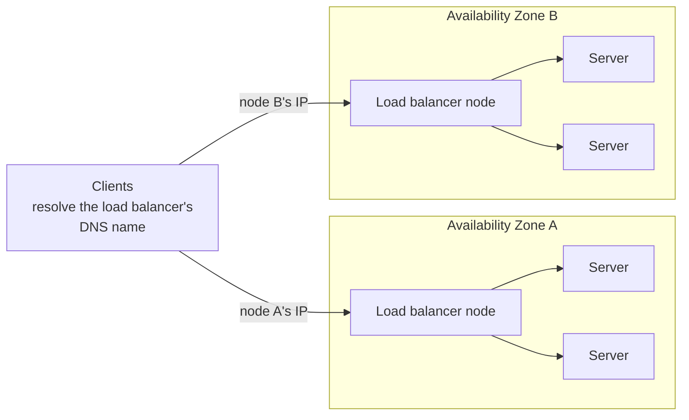
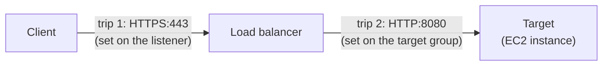
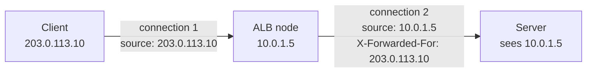
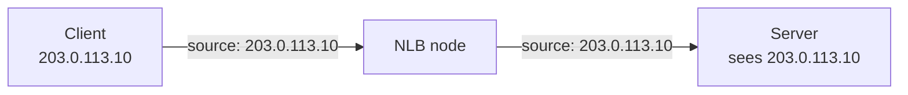
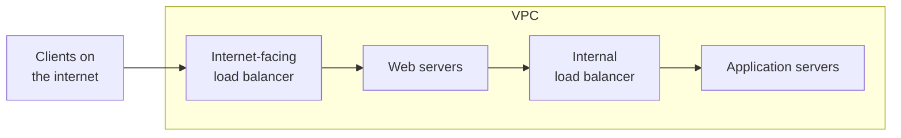

# Load balancers – Overview

This note explains what a load balancer does, independent of any one
product, with AWS examples along the way. The notes on Elastic Load
Balancing and its load balancer types (ALB, NLB, GWLB) build on it. Layer
numbers refer to [The OSI model](../networking-fundamentals/osi-model.md).

## What a load balancer is

Picture an application on a single server, with clients connecting straight
to that server's address. Three problems follow:
- **Limited capacity.** To handle more traffic, the only option is a bigger
  server. Sizes have a ceiling, and the swap usually means downtime.
- **A single point of failure**, a part whose failure takes the whole
  system down. If the server fails, the application is down.
- **Tight coupling.** Clients know the server's address, so replacing the
  server or adding a second one affects them.

A **load balancer** is a single entry point between clients and a group of
servers. Clients connect only to the load balancer, and it forwards each
request or connection to one of the healthy servers behind it. This solves
all three problems:
- Capacity grows by adding servers behind the load balancer.
- The load balancer stops sending traffic to a server that fails (see
  [Health checks](#health-checks)).
- Clients only know the load balancer's address. The list of servers
  behind it belongs to the load balancer, so servers can be added,
  replaced or removed without clients noticing. This is what makes
  automatic scaling possible: in AWS, EC2 Auto Scaling registers the
  instances it launches with the load balancer and deregisters the ones it
  terminates.

### Scaling up and scaling out

The two pairs of terms answer different questions: how big one resource is,
and how many resources there are.

| Kind | Terms | What changes | EC2 example |
|---|---|---|---|
| Vertical | Scale **up** / scale **down** | The size of one resource | From `m5.large` to `m5.2xlarge`, or back |
| Horizontal | Scale **out** / scale **in** | The number of resources | From 2 instances to 6, or back |

- **Vertical scaling** has a ceiling (the largest instance type), and the
  resource is still a single point of failure. On EC2 it also means
  downtime: an instance must be stopped before its type can change.
- **Horizontal scaling** needs something to spread the work across the
  resources, and that's the load balancer. The AWS Well-Architected
  Framework makes this a reliability principle: replace one large resource
  with several small ones, so that one failure has less impact.
- "Scale in" is not "scale down". EC2 Auto Scaling scales out and in: it
  adds and removes instances, and doesn't resize them.

### Isn't the load balancer itself a single point of failure?

It would be if it ran on one machine. "Single entry point" means one name,
not one machine:
- **Redundancy.** For each Availability Zone enabled for the load
  balancer, Elastic Load Balancing creates a **load balancer node** in that
  zone. The load balancer's DNS name resolves to the IP addresses of the
  nodes, so if one node or zone fails, the nodes in the other zones keep
  serving traffic.
- **Capacity.** Elastic Load Balancing scales the load balancer as traffic
  changes and updates its DNS entry. The entry has a TTL of 60 seconds, so
  clients pick up the new addresses quickly.

Redundancy is what removes the single point of failure; scaling only adds
capacity. This is why AWS recommends enabling several Availability Zones,
and an Application Load Balancer requires at least two.

A design that must keep working when a server or a whole zone fails
therefore combines three parts: a load balancer, servers in at least two
Availability Zones, and EC2 Auto Scaling to replace failed instances and
follow demand.

**Sources for this section:**
- [What is Elastic Load Balancing?](https://docs.aws.amazon.com/elasticloadbalancing/latest/userguide/what-is-load-balancing.html):
  - "Load balancer benefits", adding and removing compute resources without
    disrupting traffic;
  - "Related services", Auto Scaling keeps the desired number of instances
    running even if one fails, and registers and deregisters instances with
    the load balancer.
- [How Elastic Load Balancing works](https://docs.aws.amazon.com/elasticloadbalancing/latest/userguide/how-elastic-load-balancing-works.html):
  - "Availability Zones and load balancer nodes", one node per enabled zone
    and the two-zone minimum for an ALB;
  - "Request routing", the DNS name resolves to the nodes' IP addresses,
    scaling, and the 60-second TTL.
- [Change the instance type for your Amazon EC2 instance](https://docs.aws.amazon.com/AWSEC2/latest/UserGuide/change-instance-type-of-ebs-backed-instance.html):
  "Considerations", the instance must be stopped first.
- [AWS Well-Architected Framework, Reliability Pillar: Design principles](https://docs.aws.amazon.com/wellarchitected/latest/reliability-pillar/design-principles.html):
  "Scale horizontally to increase aggregate workload availability".
- [Dynamic scaling for Amazon EC2 Auto Scaling](https://docs.aws.amazon.com/autoscaling/ec2/userguide/as-scale-based-on-demand.html):
  "Multiple dynamic scaling policies", Auto Scaling groups scale out and
  scale in.

## How a load balancer works

A load balancer has three parts: a front door (the listener), a list of
servers (the target group), and a way to tell which of those servers work
(health checks).

### Listener

A **listener** checks for connections on one protocol and port, such as
HTTPS on port 443. The traffic makes two trips, and each trip has its own
protocol and port:
- **Trip 1, client to load balancer.** This is what clients see: a client
  opening `https://shop.example.com` connects with HTTPS on port 443.
- **Trip 2, load balancer to target.** The load balancer forwards the
  request to a server, and this trip can use a different protocol and
  port. For example, the application on the server might listen on port
  8080 with plain HTTP.

Because the trips are separate, the application can use any port without
clients knowing it, and the load balancer can decrypt HTTPS and send plain
HTTP to the servers (see [TLS](#who-decrypts-the-traffic)).

On an Application Load Balancer the two settings live in different places:
the listener holds trip 1, and the target group holds trip 2.

One load balancer can have several listeners. A common pair is HTTPS:443,
which forwards requests to the servers, and HTTP:80, whose only job is to
redirect clients to HTTPS. The redirect happens on the load balancer, so the
application never sees those requests.

### Target group

The general name is a server pool. In AWS it's a **target group**: the list
of registered targets that requests are forwarded to, with the protocol and
port for trip 2.
- On an ALB, a target can be an EC2 instance (by instance ID), a private
  IP address, or a Lambda function.
- **Registering** a target adds it to the list. **Deregistering** removes
  it from the list and does nothing else to the target.
- A target can belong to several target groups, but a target group can be
  used with only one load balancer.
- Health checks are set per target group.

### Health checks

The load balancer sends each target a test request at a regular interval,
and only sends traffic to targets that pass. On an ALB the test is an HTTP
`GET` to a path, and a passing answer is one of the expected status codes.
The defaults for EC2 instance and IP targets:

| Setting | Default | Meaning |
|---|---|---|
| Path | `/` | The URL that gets requested |
| Success codes | `200` | The HTTP codes that count as healthy |
| Interval | 30 seconds | Time between checks of one target (approximate) |
| Timeout | 5 seconds | No answer within this time counts as a failure |
| Unhealthy threshold | 2 | Failures in a row before the target is taken out |
| Healthy threshold | 5 | Successes in a row before it's put back |

Removing a target takes few failures, and putting it back takes more
successes: the load balancer reacts quickly to problems and waits for proof
before trusting a target again. A newly registered target is the exception:
it needs to pass a single check.

**How long it takes.** With the defaults, suppose a server crashes right
after passing a check:
- The next check comes about 30 seconds later and fails when the 5-second
  timeout runs out, at about 35 seconds.
- The second failure comes about 30 seconds after that, at about 65
  seconds, and the target is taken out. Requests sent to it in that minute
  fail.
- Once it's fixed, it needs 5 successes 30 seconds apart: about 2 to 2.5
  minutes before it gets traffic again.

A shorter interval or a lower unhealthy threshold detects failures sooner,
at the price of more check traffic and of removing a server that was only
slow for a moment.

**Choose a path that proves the application works.** If `/` answers with a
redirect, for example a `302` to a login page, every check fails with the
reason code `Target.ResponseCodeMismatch`, because `302` isn't a success
code, even though the application works. The usual fix is a dedicated path,
such as `/health`, that returns `200` when the application is ready.

**When every target fails.** If all the targets in a target group are
unhealthy, the ALB sends traffic to all of them anyway. This is called
**failing open**. When everything fails at once, the cause is more likely
the check itself (a wrong path, a blocked port) than every server at the
same time. Sending traffic to every target means users get served if the
targets actually work; refusing all traffic would guarantee an outage.

**Sources for this section:**
- [How Elastic Load Balancing works](https://docs.aws.amazon.com/elasticloadbalancing/latest/userguide/how-elastic-load-balancing-works.html):
  introduction, a listener is set up with a protocol and port for each of
  the two connections.
- [Target groups for your Application Load Balancers](https://docs.aws.amazon.com/elasticloadbalancing/latest/application/load-balancer-target-groups.html):
  - introduction, target groups route requests with the protocol and port
    you specify, one load balancer per target group, health checks per
    target group;
  - "Target type", instance, IP and Lambda targets;
  - "Registered targets", deregistering doesn't affect the target
    otherwise.
- [Action types for listener rules](https://docs.aws.amazon.com/elasticloadbalancing/latest/application/rule-action-types.html):
  "Redirect actions", redirecting HTTP to HTTPS.
- [Health checks for Application Load Balancer target groups](https://docs.aws.amazon.com/elasticloadbalancing/latest/application/target-group-health-checks.html):
  - introduction, a new target must pass one check, and the load balancer
    fails open when all targets are unhealthy;
  - "Health check settings", the GET method and the defaults;
  - "Health check reason codes", `Target.ResponseCodeMismatch`.

## Routing algorithms

Once the load balancer has its list of healthy targets, it needs a rule to
pick one of them for each request or connection. That rule is the
**routing algorithm**, and there are two broad kinds: algorithms that
spread requests, and algorithms that keep a flow together.

### Spreading requests

These algorithms choose again for every request.

| Algorithm | How it picks | Works best when |
|---|---|---|
| **Round robin** | Each target in turn: A, B, C, A, B, C… | Requests cost about the same, and targets are about the same size |
| **Least outstanding requests** | The target with the fewest requests still in progress | Requests vary in cost, or targets differ in size |
| **Weighted random** | A random healthy target, spread evenly | Like round robin, with the option to send less traffic to a misbehaving target (see below) |

Round robin and weighted random count turns; least outstanding requests
looks at the current load. Suppose a report endpoint takes 20 seconds and
every other request takes 50 milliseconds. Round robin keeps handing the
busy target its turn, while least outstanding requests sees the requests
piling up there and sends new ones elsewhere.

On an ALB, the algorithm is set per target group and can be changed at any
time. Round robin is the default. With weighted random, the ALB can also
turn on **anomaly mitigation**: it compares each target's error rate with
the others in the group and routes less traffic to a target whose errors
are well above its peers.

### Keeping a flow together: hashing

A **hash** turns some input into a number, and the same input always gives
the same number. A load balancer can hash fields of a connection and use
the result to choose a target, so every packet of that connection reaches
the same target.
- **NLB:** for TCP, it hashes the protocol, the source and destination IP
  addresses and ports, and the TCP sequence number. Each TCP connection
  stays on one target for its whole life. A new connection from the same
  client has a different source port, so it can land on another target.
- **GWLB:** it hashes the 5-tuple (protocol, source IP and port,
  destination IP and port), so all the packets of a flow reach the same
  appliance.

### Why two kinds

A load balancer can only choose based on what it can see. An ALB reads
every HTTP request, so it can choose again for each request. An NLB sees
connections and packets but not requests, so it chooses once per
connection (see [Layer 4 vs. layer 7](#layer-4-vs-layer-7)).

[Sticky sessions](#sticky-sessions) change this: the algorithm picks the
target for a client's first request, and later requests from that client
go to the same target.

**Sources for this section:**
- [Edit target group attributes for your Application Load Balancer](https://docs.aws.amazon.com/elasticloadbalancing/latest/application/edit-target-group-attributes.html):
  - "Routing algorithm", the three algorithms and when each fits, one
    algorithm per target group, sticky sessions use it only for the first
    request;
  - "Automatic Target Weights (ATW)", anomaly detection and mitigation.
- [How Elastic Load Balancing works](https://docs.aws.amazon.com/elasticloadbalancing/latest/userguide/how-elastic-load-balancing-works.html):
  "Routing algorithm", round robin as the ALB default, the NLB flow hash,
  and the GWLB 5-tuple hash.
- [What is a Network Load Balancer?](https://docs.aws.amazon.com/elasticloadbalancing/latest/network/introduction.html):
  "Network Load Balancer overview", each TCP connection is routed to a
  single target for its whole life.
- [What is a Gateway Load Balancer?](https://docs.aws.amazon.com/elasticloadbalancing/latest/gateway/introduction.html):
  "Gateway Load Balancer overview", flow stickiness to one appliance.

## Layer 4 vs. layer 7

A device in the middle of a connection can only act on the layers it reads
(see [What changes on the way](../networking-fundamentals/osi-model.md#what-changes-on-the-way)).
The same holds for load balancers: the layer a load balancer works at
decides what it can see, and therefore what it can route on.

**A layer 4 load balancer** reads IP addresses, ports and the transport
protocol (TCP or UDP), but not what's inside: no URL, no headers. It picks
a target for each connection or flow and forwards the traffic without
reading it. Because it reads so little, it's very fast, and it works with
any protocol that runs over TCP or UDP, such as databases, games or
messaging. It can't send `/api` and `/images` to different servers, because
it never sees the path. In AWS this is the **Network Load Balancer
(NLB)**, which works at layer 4 and can handle millions of requests per
second. Each NLB node gets a static IP address in its Availability Zone,
and an internet-facing NLB can use an Elastic IP address in each zone.

**A layer 7 load balancer** reads the whole HTTP request. To do that it
ends the client's TCP connection, even when there's no TLS: TCP delivers a
stream of bytes, and one HTTP request can arrive in several segments, so
only an endpoint of the connection can put the request back together. The
load balancer reads the request and sends it to the target over a second,
separate connection. Two consequences:
- **It can choose per request, on the content.** Rules can match the path,
  the host name, headers, the method, the query string or the source IP.
- **The target talks to the load balancer, not to the client.** On the
  second connection, the source IP is the load balancer node's private IP,
  so the target's logs show a few load balancer addresses instead of the
  clients (see [The client's IP](#the-clients-ip)).

In AWS this is the **Application Load Balancer (ALB)**. Its routing is set
with **listener rules**: each rule pairs one or more conditions (such as
"the path is `/api/*`") with an action (such as "forward to target group
B"), and the rules are checked in priority order. Besides forwarding, an
ALB can answer by itself: redirect HTTP to HTTPS, return a fixed response,
or authenticate users. It also works with AWS WAF. The price is more work
per request, and it handles HTTP and HTTPS only.

Separate connections also let an ALB reuse one backend connection for
requests from many clients, which AWS calls connection multiplexing.

**A layer 3 load balancer** is a special case. The **Gateway Load Balancer
(GWLB)** works at the network layer and receives every IP packet on every
port. It isn't a front door for clients. Instead, it sits in the path of
the traffic and sends each flow through a **virtual appliance** (a software
firewall, or an intrusion detection or prevention system) for inspection.
Traffic reaches it through endpoints placed in VPC route tables.

| | GWLB | NLB | ALB |
|---|---|---|---|
| OSI layer | 3 Network | 4 Transport | 7 Application |
| Reads | IP packets | IPs, ports, TCP or UDP | The whole HTTP request |
| Chooses per | Flow | Connection or flow | Request |
| Routes on content | No | No | Yes: path, host, headers… |
| Typical use | Inspection appliances in the traffic path | Non-HTTP protocols, very high performance, static IPs | Web applications, microservices |

Some requirements decide the type on their own: UDP or fixed IP addresses
rule out the ALB, whose IP addresses change as it scales, and routing on
the path or host name rules out the NLB.

**Sources for this section:**
- [What is a Network Load Balancer?](https://docs.aws.amazon.com/elasticloadbalancing/latest/network/introduction.html):
  "Network Load Balancer overview", layer 4, millions of requests per
  second, a static IP per zone and an optional Elastic IP per subnet.
- [Listeners for your Network Load Balancers](https://docs.aws.amazon.com/elasticloadbalancing/latest/network/load-balancer-listeners.html):
  "Listener configuration", the supported protocols (TCP, TLS, UDP,
  TCP_UDP, QUIC, TCP_QUIC).
- [What is an Application Load Balancer?](https://docs.aws.amazon.com/elasticloadbalancing/latest/application/introduction.html):
  - "Application Load Balancer components", listener rules with a
    priority, conditions and actions;
  - "Application Load Balancer overview", layer 7 and rules checked in
    priority order;
  - "Benefits of migrating from a Classic Load Balancer", routing on path,
    host, headers, method, query string and source IP, redirects, fixed
    responses and user authentication.
- [How Elastic Load Balancing works](https://docs.aws.amazon.com/elasticloadbalancing/latest/userguide/how-elastic-load-balancing-works.html):
  - "HTTP connections", front-end and backend connections, and connection
    multiplexing;
  - "Request routing", the load balancer scales and updates its DNS entry.
- [What is Elastic Load Balancing?](https://docs.aws.amazon.com/elasticloadbalancing/latest/userguide/what-is-load-balancing.html):
  "Related services", AWS WAF with an ALB.
- [What is a Gateway Load Balancer?](https://docs.aws.amazon.com/elasticloadbalancing/latest/gateway/introduction.html):
  "Gateway Load Balancer overview", layer 3, all IP packets on all ports,
  virtual appliances, endpoints and route tables.
- [RFC 9293, Transmission Control Protocol](https://www.rfc-editor.org/rfc/rfc9293):
  Section 2.2, TCP provides a byte-stream service, carried in segments.

## TLS and the client's IP

Once a load balancer sits in the middle, two questions follow: who decrypts
the traffic, and how the server still learns who the client is.

### Who decrypts the traffic

| Option | What happens | AWS setup |
|---|---|---|
| **Termination** | The load balancer decrypts and sends plain traffic to the targets | ALB with an HTTPS listener, or NLB with a TLS listener, and a certificate on the load balancer |
| **Re-encryption** | The load balancer decrypts, reads, then opens a new TLS connection to the target | ALB with an HTTPS listener and an HTTPS target group |
| **Passthrough** | The load balancer forwards the encrypted bytes, and the target decrypts | NLB with a TCP listener on port 443 |

- **Termination** takes the encryption work off the servers and keeps the
  certificates in one place, often issued by AWS Certificate Manager
  (ACM). On an ALB it's also what makes routing on the content possible.
  The application then only sees plain HTTP, which has a side effect (see
  [The client's IP](#the-clients-ip)).
- **Re-encryption** keeps the traffic encrypted on both trips, and the ALB
  can still route on the content. The ALB doesn't validate the targets'
  certificates, so self-signed or expired ones work; AWS's reasoning is
  that traffic inside the VPC is authenticated at the packet level.
- **Passthrough** is the only option in which the load balancer never sees
  the plain text. It's also the way to use **mutual TLS** (mTLS), where the
  client also presents a certificate, on the targets: NLBs don't support
  mTLS themselves.

Routing on the path or host name and "only the servers may decrypt" can't
both be met. The conflict isn't about whether the traffic is encrypted on
the wire, since re-encryption keeps it encrypted on both trips. It's about
who holds the keys: to read the path, the load balancer has to decrypt.

### The client's IP

**A layer 7 load balancer passes the IP in a header.** On the second
connection the source IP is the load balancer's, so an ALB adds HTTP
headers to the request:
- `X-Forwarded-For` holds the client's IP address. If the request already
  has this header, the ALB appends the address it sees to the end
  (`append` is the default mode), so the header can hold a list.
- `X-Forwarded-Proto` holds the protocol the client used (`http` or
  `https`).
- `X-Forwarded-Port` holds the port the client connected to.

A client can send its own `X-Forwarded-For` with any address in it, so the
entries are only trustworthy if they were added by systems you control. In
`append` mode, that's the last entry, the one the ALB added.

`X-Forwarded-Proto` solves a common problem with termination. Suppose the
application redirects every HTTP request to HTTPS. The browser sends HTTPS
to the ALB, the ALB sends HTTP to the application, the application
redirects to HTTPS, and the cycle repeats without end. The application
can't tell "the client used HTTP" from "the ALB used HTTP". Two fixes:
- the application redirects only when `X-Forwarded-Proto` is `http`;
- or the redirect moves to the load balancer, with an HTTP:80 listener that
  only redirects (see [Listener](#listener)), and the application never
  redirects at all.

**A layer 4 load balancer can keep the source IP.** With **client IP
preservation**, an NLB delivers the packets with the client's IP still as
the source, so the server sees the real address directly and no header is
needed. It's on by default for instance targets and for UDP, and off by
default for IP targets on TCP and TLS.

With passthrough this is the only option: the NLB can't add an HTTP header
to traffic it can't read.

When the IP can't be preserved, an NLB can use **proxy protocol version
2**: it adds a small binary header in front of the TCP data, carrying the
original source and destination. The application has to be built to read
it, or it fails.

**Sources for this section:**
- [What is Elastic Load Balancing?](https://docs.aws.amazon.com/elasticloadbalancing/latest/userguide/what-is-load-balancing.html):
  - "Load balancer benefits", offloading encryption and decryption;
  - "Related services", ACM certificates on HTTPS listeners.
- [Listeners for your Network Load Balancers](https://docs.aws.amazon.com/elasticloadbalancing/latest/network/load-balancer-listeners.html):
  - "Listener configuration", TLS listeners offload decryption, and a TCP
    listener on port 443 passes encrypted traffic through;
  - "Secure listeners", NLBs don't support mTLS, so a TCP listener passes
    it through to the targets.
- [Target groups for your Application Load Balancers](https://docs.aws.amazon.com/elasticloadbalancing/latest/application/load-balancer-target-groups.html):
  "Routing configuration", HTTPS target groups, and targets' certificates
  aren't validated.
- [HTTP headers and Application Load Balancers](https://docs.aws.amazon.com/elasticloadbalancing/latest/application/x-forwarded-headers.html):
  "X-Forwarded-For" (the `append` default, the trust warning, the example
  table), "X-Forwarded-Proto" and "X-Forwarded-Port".
- [Action types for listener rules](https://docs.aws.amazon.com/elasticloadbalancing/latest/application/rule-action-types.html):
  "Redirect actions", redirecting HTTP to HTTPS.
- [Edit target group attributes for your Network Load Balancer](https://docs.aws.amazon.com/elasticloadbalancing/latest/network/edit-target-group-attributes.html):
  - "Client IP preservation", what it does and the defaults per target
    type and protocol;
  - "Proxy protocol", the header added in front of the TCP data and the
    need for the application to read it.
- [RFC 5737, IPv4 Address Blocks Reserved for Documentation](https://www.rfc-editor.org/rfc/rfc5737):
  Section 3, the documentation address blocks.
- [RFC 1918, Address Allocation for Private Internets](https://www.rfc-editor.org/rfc/rfc1918):
  Section 3, the private address blocks.

## Sticky sessions, security boundary, safer deployments

### Sticky sessions

An application is **stateful** when a server keeps a user's data, such as
a login or a shopping cart, in its own memory. If the user's next request
reaches a different server, that data isn't there.

**Sticky sessions** (also called session affinity) bind a client to one
target, so its requests keep reaching the same server:
- An ALB uses a **cookie**: either one the load balancer creates
  (duration-based), or the application's own cookie (application-based).
  The client must accept cookies. The routing algorithm picks the target
  only for the first request; after that, the cookie decides.
- An NLB uses the **source IP**. All clients behind the same NAT device
  share one IP address, so they all reach the same target.

Stickiness has two costs:
- **Uneven load.** When new servers are added, existing users stay on the
  old ones, so the new servers get little traffic at first.
- **No real fault tolerance.** If the target fails or is deregistered, the
  load balancer picks a new one, which has none of the user's data. The
  service stays up, but the user is logged out or loses the cart.

The better design is a **stateless** application: it keeps no session data
on the server, so any server can answer any request, and servers can be
added, removed or replaced without affecting users. The session data moves
to a shared store, such as Amazon ElastiCache, Amazon DynamoDB, Amazon EFS
or Amazon MemoryDB. Sticky sessions are then a workaround for applications
that can't be changed, not a goal.

### Security boundary

The load balancer is the only part that clients reach, so the servers
behind it can stay private:
- **Targets need no public IP addresses.** Both internet-facing and
  internal load balancers reach their targets on private IP addresses.
- **Tiers can be separated.** An internet-facing load balancer sits in
  front of the web servers, and an internal load balancer, reachable only
  from inside the VPC, sits between the web servers and the application
  servers.

- **Targets accept traffic only from the load balancer.** A **security
  group** is a virtual firewall attached to a resource, made of allow
  rules. AWS recommends using the load balancer's security group as the
  source in the targets' security group. This works better than a list of
  the load balancer's IP addresses: the load balancer's addresses change as
  it scales, and the rule follows the role rather than the address, so
  anything carrying that security group is allowed and nothing else is.
- **One place for defenses.** Certificates live on the load balancer (see
  [Who decrypts the traffic](#who-decrypts-the-traffic)), and an ALB can be
  protected with AWS WAF.

### Safer deployments

Because the load balancer decides which targets get traffic, it can add and
remove servers without failed requests:
- **Deregistration delay** (also called connection draining). A target
  being deregistered enters the `draining` state: it gets no new requests,
  and the requests in progress get time to finish. The ALB default is 300
  seconds, with a range of 0 to 3,600.
- **Slow start.** A newly registered target receives a share of traffic
  that grows linearly over 30 to 900 seconds, instead of a full share at
  once, giving caches and runtimes time to warm up. On an ALB it works only
  with round robin.
- **Weighted target groups.** A listener rule can forward to two target
  groups with weights from 0 to 999. With the current version ("blue") at
  90 and the new version ("green") at 10, a tenth of the requests reach the
  new version; the weights then shift step by step, and rolling back means
  setting green to 0. If one group is empty or unhealthy, the ALB doesn't
  fail over to the other group by itself.

These pieces support three common release strategies:
- **Rolling:** replace servers a few at a time, draining each one first.
  There's no stage where only a share of users sees the new version, and
  rolling back means deploying the old version again.
- **Blue/green:** run the new version in its own target group and switch
  all traffic to it; switch back if something goes wrong.
- **Canary:** send a small weighted share of traffic to the new version
  first, and raise it as confidence grows.

Weighted target groups are what make the last two possible. Putting the new
servers in the same target group doesn't work: the new version's share is
then just its fraction of the targets, and slow start only warms up
individual targets; it doesn't split traffic between versions.

**Sources for this section:**
- [Edit target group attributes for your Application Load Balancer](https://docs.aws.amazon.com/elasticloadbalancing/latest/application/edit-target-group-attributes.html):
  - "Sticky sessions", cookie types, client support for cookies, and the
    algorithm used only for the first request;
  - "Duration-based stickiness" and "Application-based stickiness", a new
    target when the old one is unhealthy or deregistered, and "Manual
    rebalancing" when targets are added;
  - "Deregistration delay", the `draining` state and the 300-second
    default;
  - "Slow start mode", the linear increase and its algorithm limits.
- [Target groups for your Application Load Balancers](https://docs.aws.amazon.com/elasticloadbalancing/latest/application/load-balancer-target-groups.html):
  "Target group attributes", the deregistration delay range and the slow
  start duration range.
- [Edit target group attributes for your Network Load Balancer](https://docs.aws.amazon.com/elasticloadbalancing/latest/network/edit-target-group-attributes.html):
  "Sticky sessions", stickiness by source IP and clients behind a NAT
  device.
- [AWS Well-Architected Framework, Reliability Pillar: REL05-BP06 Make systems stateless where possible](https://docs.aws.amazon.com/wellarchitected/latest/reliability-pillar/rel_mitigate_interaction_failure_stateless.html):
  stateless applications, replacing servers without availability impact,
  and services to offload session data.
- [How Elastic Load Balancing works](https://docs.aws.amazon.com/elasticloadbalancing/latest/userguide/how-elastic-load-balancing-works.html):
  - "Load balancer scheme", internet-facing and internal load balancers,
    private IPs to targets, and the multi-tier example;
  - "Request routing", the load balancer scales and updates its DNS entry.
- [Security groups for your Application Load Balancer](https://docs.aws.amazon.com/elasticloadbalancing/latest/application/load-balancer-update-security-groups.html):
  "Considerations", the load balancer's security group as the source for
  the targets.
- [What is Elastic Load Balancing?](https://docs.aws.amazon.com/elasticloadbalancing/latest/userguide/what-is-load-balancing.html):
  "Related services", AWS WAF with an ALB.
- [Action types for listener rules](https://docs.aws.amazon.com/elasticloadbalancing/latest/application/rule-action-types.html):
  "Forward actions", weights from 0 to 999 and no automatic failover
  between target groups.
