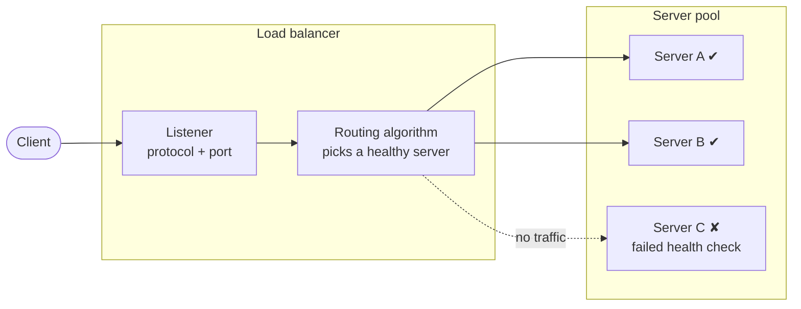
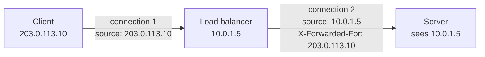
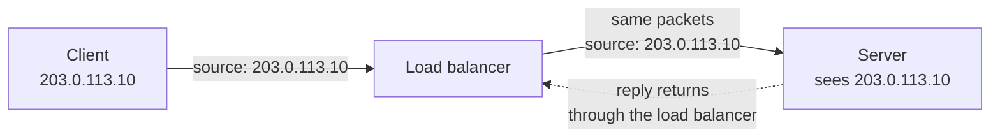

# Elastic Load Balancing (ELB) – Overview

## What a load balancer is

A load balancer is a single entry point that sits between clients and a group of servers. Clients connect to it instead of to the servers, and it forwards each request or connection to one of the healthy servers behind it. Clients see one stable address. Behind that address, the servers can be added, removed or replaced, and can fail, without clients noticing.

Without one, an application on a single server has three problems:
- **Limited capacity**. You can only scale *up* (bigger server), which has a
  ceiling and usually needs downtime.
- **Single point of failure**. If the server fails, the app is down.
- **Tight coupling**. Clients must know server addresses, so adding or
  replacing servers affects clients.

A load balancer solves all three:
- Scale *out* by adding servers behind it.
- The load balancer automatically stops sending traffic to failed servers.
- Clients only know the load balancer's address, so servers can be added,
  replaced, or terminated freely.
  - This is what makes automatic scaling practical.

### Isn't the load balancer itself a single point of failure?

It would be if it ran on one machine. "Single entry point" means one *logical*
address, backed by redundant load balancer nodes with automatic failover.

## How a load balancer works

### Listener
- **Protocol + port** the load balancer accepts traffic on (e.g. HTTPS:443),
  plus what to do with that traffic.
- One load balancer can have several listeners (e.g. HTTP:80 that only
  redirects to HTTPS:443).

### Server pool
- **Group of servers** running the same application. Also called backend
  pool or upstream; AWS calls it a *target group*.
- **Registration**. Servers join and leave manually or automatically
  (e.g. an autoscaler adding and removing them).
- **Multiple pools**. One load balancer can route to different pools. Content-based routing needs a layer 7 load balancer.

### Health checks
- **Active**. The load balancer probes each server on a schedule
  (e.g. `GET /health`, expect HTTP 200 within a timeout).
- **Passive**. It watches real traffic for errors and failed connections.
- **Thresholds**. N consecutive failures → unhealthy; M consecutive
  successes → healthy again. Prevents flapping on a single slow response.
- **Shallow vs deep**.
  - Shallow ("is the process up?") is cheap and safe.
  - Deep ("can it reach the database?") is more accurate but risky: if a
    shared dependency fails, *every* server fails its check and the whole
    pool is removed.
- **Connection draining**. Before a server is removed, it gets no new
  requests but in-flight requests can finish within a timeout.

### Routing algorithm
- Decides **which healthy server** gets the next request or connection.
- Common ones: round robin, weighted round robin, least connections /
  least outstanding requests, and hash-based.
- Health checks decide **which** servers are eligible; the algorithm decides
  **how** traffic is spread among them.

## What else a load balancer does

Beyond scaling, availability, and a single entry point (see above):

### TLS termination
| Mode | How | Why |
|---|---|---|
| **Termination** | LB decrypts, sends plain HTTP to servers | Certificates live in one place, less server work, enables layer 7 routing |
| **Re-encryption** | LB decrypts, inspects, re-encrypts to servers | Layer 7 routing *and* end-to-end encryption (compliance) |
| **Passthrough** | LB forwards encrypted bytes; server decrypts | Only the server holds the key; no layer 7 routing possible |

### Sticky sessions (session affinity)

Some applications keep session data, such as a shopping cart or a login,
**in the memory of one server**. If the client's next request goes to a
different server, that session is lost. Sticky sessions solve this by
sending a client to the same server every time, usually with a cookie set
by the load balancer or the application, and sometimes with a hash of the
source IP.

Stickiness comes at a cost. The load balancer can no longer spread requests
freely, so a few heavy users pinned to the same server can overload it while
others sit idle. It also doesn't really protect the session: if that server
fails or is removed during scale-in, its users lose their sessions anyway.

The better design is **stateless servers with session data in a shared
store** (a cache or database). Any server can then handle any request, and
stickiness isn't needed. Treat sticky sessions as a workaround for legacy
applications, not a goal.

### Security boundary
- Only the load balancer is internet-facing. Servers stay private and accept
  traffic **only from the load balancer**.
- A natural place for extra protection (web application firewall, DDoS
  absorption).

### Real client IP
- A **proxying** load balancer opens its own connection to the server, so the
  server sees the **load balancer's IP**, not the client's. The original IP
  must be passed along as data: `X-Forwarded-For` header (layer 7) or
  Proxy Protocol (layer 4).

- A **forwarding** load balancer passes the client's packets to the server
  without replacing the source address. It **preserves the source IP**, so the
  server sees the real IP directly and no header is needed. Layer 7 load
  balancers always proxy; layer 4 can do either.

### Safer deployments

Because the load balancer controls which servers get traffic, it supports
zero-downtime releases:
- **Rolling**. Replace servers a few at a time, draining each first.
- **Blue/green**. Switch all traffic from the old pool to the new one;
  switch back on failure.
- **Canary**. Send a small weighted share of traffic to the new version first.
