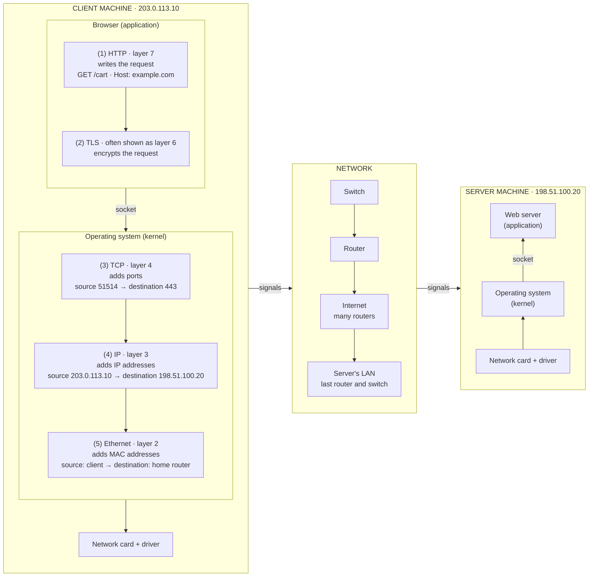

# The journey of an HTTPS request

This note follows one HTTPS request, `GET /cart` for `example.com`, from a
browser to a web server. It goes one step at a time and shows what each layer
adds on the client and removes on the server. For an overview of the layers,
see [The OSI model](osi-model.md).

The client is `203.0.113.10` and the server is `198.51.100.20`. Both are
addresses reserved for documentation.

**Sources for this section:**
- [RFC 5737, IPv4 Address Blocks Reserved for Documentation](https://www.rfc-editor.org/rfc/rfc5737):
  Section 3, the documentation address blocks.

## The path



## How to read the steps

Each step ends with a line called "Message so far". It shows what the data
looks like once that step is done:

- **Square brackets** enclose the whole message as it exists at that point.
- **Each name** inside is a piece added by one layer, such as `TCP` for the
  TCP header.
- **A vertical bar** separates the pieces. They appear in the order they are
  sent, leftmost first.
- **Curly braces** mark content that is encrypted: `{HTTP}` is the HTTP
  request, present but unreadable.

For example, `[ TCP | TLS {HTTP} ]` is a message with a TCP header followed by
the HTTP request encrypted by TLS.

On the client, each step adds a piece, normally in front of what was already
there, so the message grows. On the server, each step removes one, until only
the HTTP request is left.

## Step 1: HTTP writes the request (layer 7)

The journey starts inside the browser. The user has asked for a page, and the
browser turns that into a message the web server can understand: an HTTP
request.

```
GET /cart HTTP/1.1
Host: example.com
```

`GET` is the method (the action), `/cart` is the path (what to fetch), and
`Host` is a header that names the site the request is for.

Before step 1, DNS resolution has already turned the domain name `example.com`
into the server's IP address. The port is inferred from the scheme: `https://`
means port 443 and `http://` means port 80, the default ports defined by the
HTTP standard.

The IP address identifies a machine on a network (in this case, the internet).
Strictly, it identifies one of the machine's network interfaces: a machine can
have several, each with its own address. The port identifies one program on
that machine: here, the web server software (for example Nginx, Apache or a
Node.js app) listening on port 443. That one program can serve several sites
on the same IP address and port, so the request needs the `Host` header to
identify the site.

The request doesn't include data such as the IP address, the port or the MAC
address, even though the browser already knows some of it (the IP address and
the port). Adding that information is the job of the lower layers.

This step shows what layer 7 is about: letting applications communicate with
each other. It does this through application-level protocols such as HTTP, SSH
and DNS. Layer 7 isn't the browser window or the business logic behind an API;
it's the protocols that make the communication possible, and the part of each
program that builds and parses their messages. A layer 7 protocol defines both
the structure of its messages and their meaning (for example, what a `GET`
request asks for). It is usually implemented by the application itself, while
the operating system normally provides layers 3 and 4. Layer 7 does nothing to
transport or deliver its messages; it hands them to the layers below.

"Application" here means neither the frontend nor the backend. Both are code
that uses layer 7; they don't implement it. The application is the program at
each end of the conversation that builds and parses the HTTP messages. In this
case, that's the browser (Chrome, Firefox) on the client side and the web
server software (Nginx, Apache, Node.js's built-in HTTP module) on the server
side. Your frontend JavaScript calls `fetch()`, and the browser builds the
HTTP request. Your backend business logic receives a request that has already
been parsed.

Message so far: `[ HTTP ]`

**Sources for this step:**
- [RFC 9110, HTTP Semantics](https://www.rfc-editor.org/rfc/rfc9110):
  Section 9.3.1, the GET method; Section 7.2, the `Host` header; Sections 4.2.1
  and 4.2.2, default ports 80 and 443.
- [RFC 9112, HTTP/1.1](https://www.rfc-editor.org/rfc/rfc9112):
  Section 3, the request line; Section 3.2, `Host` is required in every HTTP/1.1
  request.
- [WHATWG Fetch Standard](https://fetch.spec.whatwg.org/#forbidden-request-header):
  Section 2.2.2, `Host` is a forbidden request-header, so the browser sets it.
- [RFC 1034, Domain Names: Concepts and Facilities](https://www.rfc-editor.org/rfc/rfc1034):
  Section 5.2.1, resolvers translate host names into addresses.
- [RFC 1122, Requirements for Internet Hosts: Communication Layers](https://www.rfc-editor.org/rfc/rfc1122):
  Section 1.3.3, an IP address identifies a logical network interface, and a
  host can have several; Section 1.1.3, the application layer.
- [RFC 9293, Transmission Control Protocol](https://www.rfc-editor.org/rfc/rfc9293):
  Section 2.2, ports identify application services.
- [nginx: How nginx processes a request](https://nginx.org/en/docs/http/request_processing.html):
  "Name-based virtual servers", choosing a site by the `Host` header.
- [Node.js `http` module](https://nodejs.org/api/http.html):
  introduction, the module parses messages into headers and body.
- [ITU-T X.200 (07/94), the OSI reference model](https://www.itu.int/rec/T-REC-X.200-199407-I/en):
  clause 7.1, the Application Layer.

## Step 2: TLS encrypts the request (often shown as layer 6)

The HTTP request from step 1 isn't encrypted. If the browser sent it as is,
anyone who could see the traffic on its way to the server (such as someone
on the same Wi-Fi network, or any router along the path) could read it.
That's why the browser passes it through TLS before handing it to the lower
layers for delivery.

TLS (Transport Layer Security) is a protocol that creates a secure channel
between two programs communicating over a network, such as a browser and a
web server. It gives that channel three guarantees: the server is always
authenticated with a certificate and a signature, so the browser knows who
it's talking to; only the two ends can read the data, because TLS encrypts it
(confidentiality); and nobody in between can change the data without being
detected (integrity). TLS doesn't deliver data itself: it relies on the layer
below to deliver its bytes complete and in order, which TCP does.

The channel is set up by the TLS handshake, a short exchange in which the
browser and the server agree on the cryptographic algorithms to use, the
server proves its identity, and both sides end up with shared keys that only
they know. It happens once per connection, right after the TCP connection is
established and before the first HTTP request; every request and response on
that connection is then protected with those keys.

HTTPS is HTTP sent through TLS. The messages are the same HTTP messages from
step 1, with the same methods and headers; what changes is that they travel
inside the TLS channel instead of as they are. An `https://` URL tells the
browser three things: it must set up TLS before sending any request, it must
check that the server's certificate matches the host in the URL (here,
`example.com`), and it connects to port 443. `http://example.com/cart` and
`https://example.com/cart` aren't the same resource reached two ways; the
HTTP standard treats them as separate sites.

Message so far: `[ TLS {HTTP} ]`. Together, `TLS {HTTP}` is what HTTPS
means: an HTTP request inside the TLS channel.

**Sources for this step:**
- [RFC 9846, TLS 1.3](https://www.rfc-editor.org/rfc/rfc9846) (replaces
  RFC 8446): Section 1, what TLS guarantees and its need for a reliable,
  in-order transport; Section 2, the handshake and the keys that protect traffic
  after it; Sections 4.5.1 and 4.5.2, the server's certificate and signature.
- [RFC 5280, X.509 Certificates](https://www.rfc-editor.org/rfc/rfc5280):
  Sections 3.1 and 3.2, certificates bind a public key to a subject and are
  signed by a certificate authority.
- [RFC 9110, HTTP Semantics](https://www.rfc-editor.org/rfc/rfc9110):
  Section 4.2.2, the `https` scheme, port 443, and no shared identity with
  `http`; Section 4.3.4, the certificate must match the host.

## Step 3: TCP adds ports (layer 4)

The browser hands `TLS {HTTP}` to the operating system through the socket.
From here down, the work is done by the operating system's kernel, not the
browser. The kernel first passes the data to TCP (Transmission Control
Protocol), which puts a TCP header in front of it.

The header carries two ports. The destination port, 443, identifies the web
server program on the server machine. The source port is a temporary number
the operating system picks for this connection, such as 51514. Ports chosen
this way are called ephemeral ports. The server sends its reply to that port,
which is how the client's operating system knows which connection, and so
which browser tab, the reply belongs to.

TCP has two jobs. The first is reaching the right program. The IP address
added in step 4 gets the data to the right machine, and the port gets it to
the right program on that machine. The second is delivering the data complete
and in order. Data can be lost, damaged or reordered on the way. TCP detects
that, resends what was lost and puts the bytes back in order. This is the
reliable delivery that step 2 said TLS depends on. To provide it, TCP first
sets up a connection between the two ends. That's the TCP connection the TLS
handshake waits for.

TCP sends data in pieces called segments, each with its own TCP header. A
large response may need many segments, but our request is small and fits in
one.

The ports are what layer 4 devices and services read later. On AWS, a
security group allows traffic by protocol, port and source, for example "TCP
port 443 from anywhere". It can see the port, but not `/cart`, which is inside
the encrypted HTTP request. A Network Load Balancer (NLB) also works at this
layer. It listens on a protocol and port and forwards each TCP connection to a
target, without reading the HTTP request. On the server, the operating system
uses destination port 443 to hand the data to the web server.

Message so far: `[ TCP | TLS {HTTP} ]`

**Sources for this step:**
- [RFC 9293, Transmission Control Protocol](https://www.rfc-editor.org/rfc/rfc9293):
  Section 2.2, ports, segments, and reliable, in-order delivery; Section 3.8,
  retransmission.
- [RFC 6056, Transport-Protocol Port Randomization](https://www.rfc-editor.org/rfc/rfc6056):
  Section 1, ephemeral ports are chosen by the networking stack.
- [ITU-T X.200 (07/94), the OSI reference model](https://www.itu.int/rec/T-REC-X.200-199407-I/en):
  clause 7.4.4.1.1, transport functions such as sequence control and error
  recovery.
- [Amazon VPC User Guide: Security group rules](https://docs.aws.amazon.com/vpc/latest/userguide/security-group-rules.html):
  "Components of a security group rule", protocol, port range and source.
- [Elastic Load Balancing: What is a Network Load Balancer?](https://docs.aws.amazon.com/elasticloadbalancing/latest/network/introduction.html):
  "Network Load Balancer overview", it works at layer 4; "Network Load Balancer
  components", listeners use a protocol and port.

## Step 4: IP adds addresses (layer 3)

Still inside the kernel, TCP hands the segment to IP (Internet Protocol),
which puts an IP header in front of it.

The header carries two addresses. The destination address, `198.51.100.20`,
is the server; DNS resolution found it before step 1. The source address,
`203.0.113.10`, is the client, so the server knows where to send the reply.
The header also records which protocol is inside (here, TCP) and a counter
called TTL (time to live), explained below. With the IP header added, the
data is called a packet.

IP has one job: getting data from one machine to another across many
networks. The port from step 3 picks the program, but only once the data has
reached the right machine. Getting it there is IP's job.

No device knows the whole path from the client to the server. Each router
only decides where the packet should go next, and each of those moves is
called a hop:

```
client → home router → ISP router → … many routers … → server's router → server
```

The first decision is made on the client. The kernel checks whether the
destination is on its own local network. It isn't, so the packet goes to the
default gateway, the nearest router. From there, every router does the same
thing: it reads the destination IP address, looks it up in its route table,
and forwards the packet to the next router. When several routes match, it
uses the most specific one. Routers don't read the ports or the HTTP request;
the destination address is all they need.

Each router also lowers the TTL by one. If the TTL reaches zero, the router
discards the packet and tells the sender. This stops a packet from circling
forever when routes are misconfigured. In IPv6, the same field is called Hop
Limit, which describes what it does in practice.

Two things follow from working hop by hop. First, the IP addresses stay the
same from end to end: every router sees source `203.0.113.10` and destination
`198.51.100.20`. Second, reaching the next router requires that router's
address on the local network, which IP doesn't provide. That's step 5.

IP doesn't guarantee delivery. Packets can arrive damaged, duplicated, out
of order, or not at all, and IP doesn't fix that. That's why TCP's
reliability from step 3 sits on top of it: IP moves each packet toward the
right machine, and TCP makes sure all the data arrives complete and in order.

On AWS, a VPC route table decides where traffic leaving a subnet goes next,
as a router's route table does. Each route has a destination, a range of IP
addresses written as a CIDR block, and a target, such as an internet gateway.
Traffic is matched by its destination IP address, and the most specific route
wins. A route `0.0.0.0/0 → internet gateway` matches every address, so
anything without a more specific route goes out to the internet. A network
ACL (NACL) filters traffic as it enters and leaves a subnet. Its rules match
on protocol, port range, and source or destination IP range, so like a
security group it reads layers 3 and 4. Unlike a security group, a NACL is
stateless: allowing inbound port 443 doesn't automatically allow the reply.
The reply goes back to the client's ephemeral port from step 3, so it needs
its own outbound rule. When the packet reaches the server, the server's
operating system sees that the destination address is its own, removes the
IP header, and passes the segment to TCP.

Message so far: `[ IP | TCP | TLS {HTTP} ]`

**Sources for this step:**
- [RFC 791, Internet Protocol](https://www.rfc-editor.org/rfc/rfc791):
  Section 1.2, delivery across interconnected networks, with no reliability
  mechanisms; Section 2.2, a datagram's path through a gateway; Section 3.1,
  the Time to Live and Protocol fields.
- [RFC 1122, Requirements for Internet Hosts: Communication Layers](https://www.rfc-editor.org/rfc/rfc1122):
  Section 1.1.3, IP gives no delivery guarantees; Section 3.2.1.3, a host
  discards datagrams not addressed to it; Sections 3.3.1 and 3.3.1.1, the
  local/remote decision and sending to a gateway.
- [RFC 1812, Requirements for IP Version 4 Routers](https://www.rfc-editor.org/rfc/rfc1812):
  Section 5.2.4.3, choosing the longest matching route; Section 5.3.1, each
  router lowers the TTL, and a packet at zero is discarded and reported.
- [RFC 8200, IPv6](https://www.rfc-editor.org/rfc/rfc8200):
  Section 3, the Hop Limit field.
- [Amazon VPC User Guide: Configure route tables](https://docs.aws.amazon.com/vpc/latest/userguide/VPC_Route_Tables.html):
  routes have a destination and a target, matched by destination IP address.
- [Amazon VPC User Guide: How route priority works](https://docs.aws.amazon.com/vpc/latest/userguide/route-tables-priority.html):
  "Longest prefix match", the most specific route wins.
- [Amazon VPC User Guide: Control subnet traffic with network ACLs](https://docs.aws.amazon.com/vpc/latest/userguide/vpc-network-acls.html):
  "Network ACL basics", subnet level and stateless.
- [Amazon VPC User Guide: Network ACL rules](https://docs.aws.amazon.com/vpc/latest/userguide/nacl-rules.html):
  the parts of a rule: protocol, port range, source or destination, allow or
  deny.

## Step 5: Ethernet adds the next device's address (layer 2)

Still inside the kernel, IP hands the packet down to Ethernet, together with
the address of the next hop it chose in step 4: the default gateway, the home
router. Ethernet puts an Ethernet header in front of the packet. The packet
then goes to the network card through its driver.

The header carries two MAC addresses. A MAC address identifies one network
interface, such as a network card. The destination MAC address,
`00:00:5e:00:53:02`, is the home router's interface. The source MAC address,
`00:00:5e:00:53:01`, is the client's network card. The header also records
what is inside, here an IPv4 packet. With the Ethernet header added, the data
is called a frame.

Ethernet has one job: getting the frame to the next device on the same local
network. IP and Ethernet answer different questions. The destination IP
address says where the data is going in the end. The destination MAC address
says who gets it next. Both kinds of address belong to a network interface,
not to a whole machine: a router has one interface on each network it
connects, each with its own addresses.

The client knows the router's IP address from its settings, but a frame needs
the router's MAC address. To find it, the client uses ARP (Address Resolution
Protocol). It sends a request to every device on the local network, asking
which device has that IP address. The router replies with its MAC address, and
the client keeps the answer in a cache, so it doesn't ask again for every
packet. IPv6 does the same job with Neighbor Discovery.

This is how the hops from step 4 happen. Each router removes the frame it
received, updates the IP header (for example, it lowers the TTL), and puts the
packet in a new frame for the next network. In the new frame, the source MAC
address is the router's own interface and the destination is the next router.
So the MAC addresses change at every hop, while the IP addresses stay the
same. The server's MAC address only appears on the last link, from the
server's router to the server.

Several kinds of device handle the frame on the way, and each reads only what
its job needs:

| Device | Layer | Connects | Reads |
|---|---|---|---|
| Switch | 2 | Devices on one local network | Destination MAC address |
| Router | 3 | Different networks | Destination IP address |
| Wi-Fi access point | 2 | Wireless devices to the local network | MAC addresses |

A switch learns which MAC addresses are on each of its ports and forwards
each frame by its destination MAC address. It works below IP, so it doesn't
read IP addresses. A router is the device that removes the frame and builds a
new one, as described above.

If the client is on Wi-Fi, the first link uses Wi-Fi frames instead of
Ethernet frames. They have the same job and also use MAC addresses. Ethernet
also covers layer 1: an "Ethernet cable" is a cable built to the physical
part of the Ethernet standard. That part is step 6.

On AWS, layer 2 is hidden. There are no switches to configure; what you
configure is routing, in route tables (step 4). Each elastic
network interface (ENI) has a MAC address, along with its IP addresses and
security groups. When an ENI is moved to another instance, its attributes,
including the MAC address, move with it. The VPC doesn't forward broadcast
frames between interfaces, and AWS checks that the MAC addresses in a frame
belong to the interfaces sending and receiving it. When the frame reaches the
server, the server's network card sees that the destination MAC address is
its own, the kernel removes the Ethernet header, and passes the packet to IP.

Message so far: `[ ETH | IP | TCP | TLS {HTTP} ]`

**Sources for this step:**
- [RFC 894, Transmission of IP Datagrams over Ethernet Networks](https://www.rfc-editor.org/rfc/rfc894):
  "Frame Format", IP packets are carried in Ethernet frames, with a type
  field for IP.
- [RFC 826, An Ethernet Address Resolution Protocol](https://www.rfc-editor.org/rfc/rfc826):
  "Packet Generation", ARP finds the 48-bit Ethernet address for an IP address
  by broadcasting a request, and keeps answers in a table.
- [RFC 1122, Requirements for Internet Hosts: Communication Layers](https://www.rfc-editor.org/rfc/rfc1122):
  Section 2.3.2.1, the ARP cache.
- [RFC 4861, Neighbor Discovery for IPv6](https://www.rfc-editor.org/rfc/rfc4861):
  Section 1, address resolution in IPv6.
- [RFC 1812, Requirements for IP Version 4 Routers](https://www.rfc-editor.org/rfc/rfc1812):
  Section 1, a router removes the link layer header, changes the IP header,
  and adds a new link layer header.
- [RFC 4188, Definitions of Managed Objects for Bridges](https://www.rfc-editor.org/rfc/rfc4188):
  Section 3, bridges (switches) connect local network segments below the
  network layer.
- [RFC 7368, IPv6 Home Networking Architecture Principles](https://www.rfc-editor.org/rfc/rfc7368):
  Section 3.2.1, a switch learns MAC addresses on its ports.
- [RFC 9542, IANA Considerations and IETF Protocol and Documentation Usage for IEEE 802 Parameters](https://www.rfc-editor.org/rfc/rfc9542):
  Section 2.1.4, MAC addresses reserved for documentation.
- [IEEE 802.3-2022, Standard for Ethernet](https://standards.ieee.org/ieee/802.3/10422/):
  Ethernet defines both the MAC (layer 2) and the physical layer (layer 1).
- [Amazon EC2 User Guide: Elastic network interfaces](https://docs.aws.amazon.com/AWSEC2/latest/UserGuide/using-eni.html):
  a network interface has a MAC address, and its attributes follow it to
  another instance.
- [AWS Networking blog: Setting up Layer 2 networking on Amazon EC2](https://aws.amazon.com/blogs/networking-and-content-delivery/setting-up-layer-2-networking-on-amazon-ec2/):
  the VPC doesn't forward broadcast and multicast frames between ENIs; the
  hypervisor checks MAC addresses.
