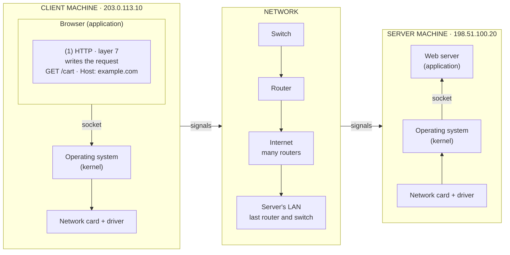

# The journey of an HTTPS request

This note follows one HTTPS request, `GET /cart` for `example.com`, from a
browser to a web server. It goes one step at a time and shows what each layer
adds on the client and removes on the server.

The client is `203.0.113.10` and the server is `198.51.100.20`. Both are
addresses reserved for documentation.

## The path



## How to read the steps

Each step ends with a line called "Message so far". It shows what the data
looks like once that step is done:

- **Square brackets** enclose the whole message as it exists at that point.
- **Each name** inside is a piece added by one layer, such as `TCP` for the
  TCP header.
- **A vertical bar** separates the pieces. They appear in the order they are
  sent, leftmost first.
- **Curly braces** mark content that is encrypted: `{HTTP}` is the HTTP
  request, present but unreadable.

For example, `[ TCP | TLS {HTTP} ]` is a message with a TCP header followed by
the HTTP request encrypted by TLS.

On the client, each step adds a piece, normally in front of what was already
there, so the message grows. On the server, each step removes one, until only
the HTTP request is left.

## Step 1: HTTP writes the request

The journey starts inside the browser. The user has asked for a page, and the
browser turns that into a message the web server can understand: an HTTP
request.

```
GET /cart HTTP/1.1
Host: example.com
```

`GET` is the method (the action), `/cart` is the path (what to fetch), and
`Host` is a header that names the site the request is for.

Before step 1, DNS resolution has already turned the domain name `example.com`
into the server's IP address. The port is inferred from the scheme: `https://`
means port 443 and `http://` means port 80, the default ports defined by the
HTTP standard.

The IP address identifies a machine on a network (in this case, the internet).
Strictly, it identifies one of the machine's network interfaces: a machine can
have several, each with its own address. The port identifies one program on
that machine: here, the web server software (for example Nginx, Apache or a
Node.js app) listening on port 443. That one program can serve several sites
on the same IP address and port, so the request needs the `Host` header to
identify the site.

The request doesn't include data such as the IP address, the port or the MAC
address, even though the browser already knows some of it (the IP address and
the port). Adding that information is the job of the lower layers.

This step shows what layer 7 is about: letting applications communicate with
each other. It does this through application-level protocols such as HTTP, SSH
and DNS. Layer 7 isn't the browser window or the business logic behind an API;
it's the protocols that make the communication possible, and the part of each
program that builds and parses their messages. A layer 7 protocol defines both
the structure of its messages and their meaning (for example, what a `GET`
request asks for). It is usually implemented by the application itself, while
the operating system normally provides layers 3 and 4. Layer 7 does nothing to
transport or deliver its messages; it hands them to the layers below.

"Application" here means neither the frontend nor the backend. Both are code
that uses layer 7; they don't implement it. The application is the program at
each end of the conversation that builds and parses the HTTP messages. In this
case, that's the browser (Chrome, Firefox) on the client side and the web
server software (Nginx, Apache, Node.js's built-in HTTP module) on the server
side. Your frontend JavaScript calls `fetch()`, and the browser builds the
HTTP request. Your backend business logic receives a request that has already
been parsed.

Message so far: `[ HTTP ]`

## Sources

- [ITU-T X.200 (07/94), the OSI reference model](https://www.itu.int/rec/T-REC-X.200-199407-I/en):
  clause 7.1, the Application Layer.
- [RFC 1034, Domain Names: Concepts and Facilities](https://www.rfc-editor.org/rfc/rfc1034):
  name-to-address translation.
- [RFC 1122, Requirements for Internet Hosts: Communication Layers](https://www.rfc-editor.org/rfc/rfc1122):
  the application layer, and IP addresses per network interface.
- [RFC 5737, IPv4 Address Blocks Reserved for Documentation](https://www.rfc-editor.org/rfc/rfc5737).
- [RFC 9110, HTTP Semantics](https://www.rfc-editor.org/rfc/rfc9110):
  default ports, methods, the `Host` header.
- [RFC 9112, HTTP/1.1](https://www.rfc-editor.org/rfc/rfc9112):
  the request line, and `Host` as a required header.
- [RFC 9293, Transmission Control Protocol](https://www.rfc-editor.org/rfc/rfc9293):
  what ports identify.
- [WHATWG Fetch Standard](https://fetch.spec.whatwg.org/):
  headers the browser controls, such as `Host`.
- [nginx: How nginx processes a request](https://nginx.org/en/docs/http/request_processing.html):
  choosing a site by the `Host` header.
- [Node.js `http` module](https://nodejs.org/api/http.html):
  message parsing.
